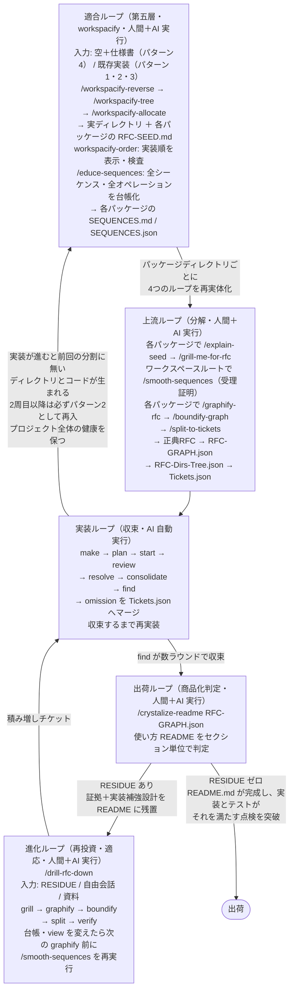
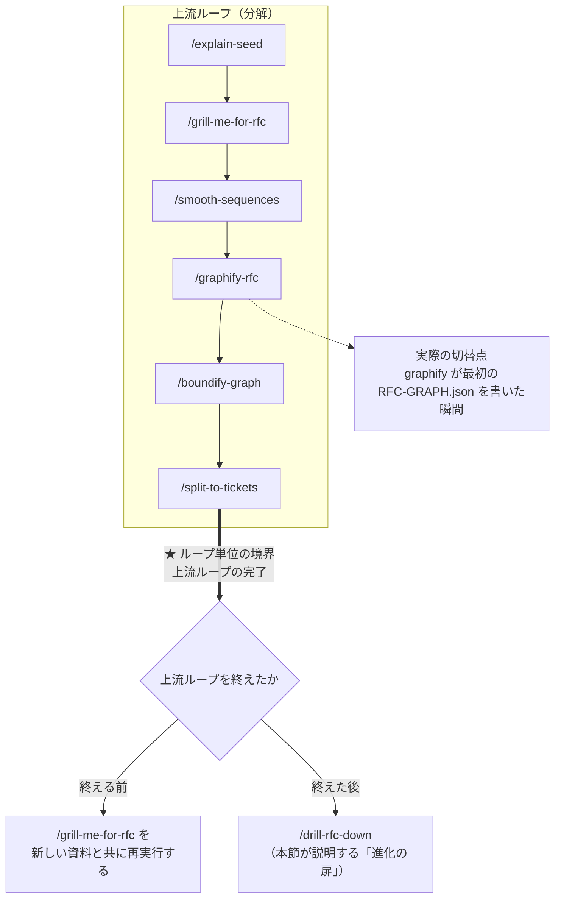
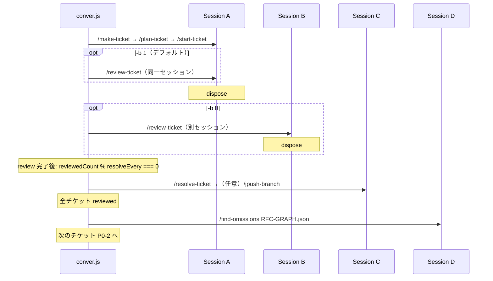
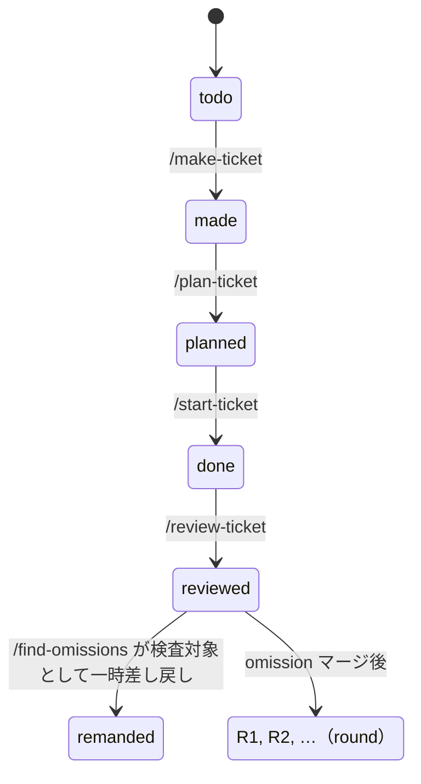
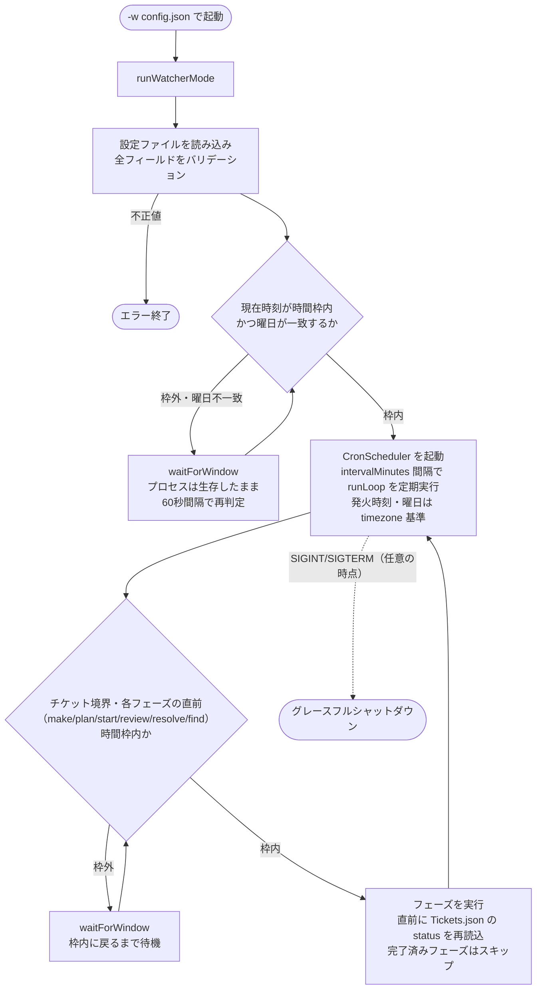
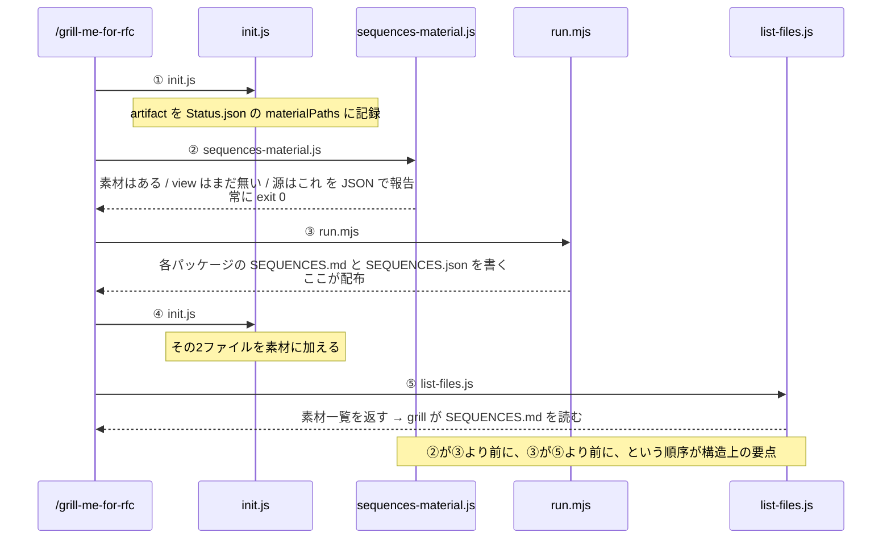
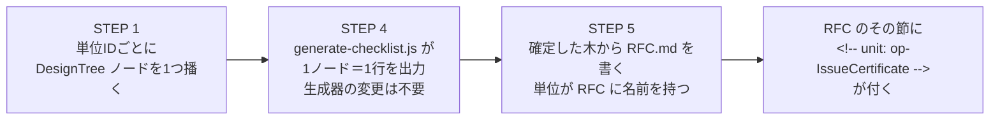

# conver — RFC収束型5層ループ開発パイプライン 

conver は、**「正典 RFC へ実装を収束させる」** と同時に、**「正典自体を安全に進化させ続ける」** ことを可能にする、5つの層から成る開発パイプラインです。**適合ループ**（第五層・workspacify）が、続く4つのループ（上流・実装・出荷・進化）を包み込みます。

## なぜ必要か — 変化し続けるビジネスと「再投資可能性」 

ソフトウェアは「一度作って完成」ではありません。市場は刻一刻と変化し、ビジネスはその変化に**進化という形で常に適応**し続けなければなりません。機能追加・方向転換・新要件への対応——これらはすべて「開発への再投資」です。

しかし長期にわたる開発で最も恐ろしいのは、**「変化がシステムを矛盾だらけにする」**ことです。過去の設計判断がどこに記録されたか分からなくなり、実装が設計から乖離し、テストが嘘をつき始める——そうなると再投資はリスクにしかならず、ビジネスは変化を諦めるか、破壊的な作り直しを強いられます。

conver はこの問題を、**「正典 RFC」を中心とした4つのループ**と、その外側で4つのループの前提を整える**適合ループ**で解決します。適合ループはワークスペースをパッケージに分割し、**4つのループをパッケージディレクトリごとに再実体化**します。

- **適合ループ（第五層・workspacify）**: 入力（空＋仕様書、または既存実装）を、4つのループが回る形へ適合させる。既存実装は逆回転で、空のプロジェクトは順回転で、同じ終端状態へ到達する。分割後は安全な実装順を示し、仕様書から全シーケンス・全オペレーションの要求台帳を作る
- **上流ループ（分解）**: AIと人間が共同で 正典 RFC を書き、全パッケージ横断の受理証明を得てから、論理グラフ化し、ディレクトリ境界を決め、チケットに分解する
- **実装ループ（収束）**: AIが全チケットを自動実装し、RFC 設計とのギャップを計測・解消して収束させる
- **出荷ループ（商品化判定）**: 「ユーザーにとっての使い方がユーザーにとって素敵か」という視点から実装を解析・検証し、不足（RESIDUE）を洗い出す。RESIDUE がゼロになり、「ユーザーにとって素敵な使い方」が README.md として書き上がり、実装とテストがそれを満たすことが点検突破した状態を「出荷」とする。
- **進化ループ（再投資）**: 正典 RFC・グラフ・ディレクトリ構造・チケットを「差分」として矛盾なく進化させ、新たなチケットを生み出す。ビジネスの再投資と進化・適応を安全に進めるための装置である。

**すべての設計判断は正典 RFC に集約され、実装はそこへ機械的に収束します。** そして正典自体を変化させる時も、グラフ・ディレクトリ構造・チケット・実装・テストが**矛盾なく連動して進化**するため、「安全な連続性を失わないビジネス上の再投資可能性」が技術的・物理的に保証されます。

---

## 全体像 — 5層ループが出荷に至るまで



| 層（ループ） | 実行主体 | コマンド | 責務 |
|--------|----------|----------|------|
| **適合ループ（第五層）** | 人間＋AI（Claude Code 上で実行） | `/workspacify-reverse` → `/workspacify-tree` → `/workspacify-allocate` → `workspacify-order`（実装順の表示・検査） → `/educe-sequences`（要求台帳） | 入力（空＋仕様書 / 既存実装）を4つのループが回る形へ適合させ、**4つのループをパッケージディレクトリごとに再実体化**する。全シーケンス・全オペレーションを台帳化し、安全な実装順を機械的に示す。一周で終わらず、内側が実装を進めるたびに繰り返す |
| **上流ループ** | 人間＋AI（`/smooth-sequences` は AI 自動実行） | `/explain-seed` → `/grill-me-for-rfc` → `/smooth-sequences` → `/graphify-rfc` → `/boundify-graph` → `/split-to-tickets` | 種の事実と説明 → RFC 設計書の作成 → **全パッケージ横断の受理証明**（列挙・契約・配布の閉包） → 論理グラフ化 → ディレクトリ境界生成 → チケット分解 |
| **実装ループ** | AI（`conver.js` が自動実行） | `/make-ticket` → `/plan-ticket` → `/start-ticket` → `/review-ticket` → `/resolve-ticket` → `/consolidate-stubs` → `/find-omissions` | チケット実装（冒頭の前提ゲートで依存順を強制） → 品質検証 → 警告・犯罪・スタブ解決 → スタブのチケット単位束ね直し → 契約ギャップ計測 → 収束 |
| **出荷ループ** | 人間＋AI（Claude Code 上で実行） | `/crystalize-readme` | 使い方 README をセクション単位で「ユーザーにとって素敵か」の視点で検証し、書けないセクションを RESIDUE として洗い出す。RESIDUE ゼロで「素敵な使い方」が README.md に書き上がり、実装とテストがそれを満たす点検突破で出荷 |
| **進化ループ** | 人間＋AI（Claude Code 上で実行） | `/drill-rfc-down` | RESIDUE・自由会話・資料を入力に grill で詳細を確定し、正典RFC・GRAPH・Dirs-Tree・Tickets を差分として矛盾なく進化させ、最後に verify で5成果物（RFC / GRAPH / Dirs-Tree / src / Tickets）の相互整合性を6チェックで機械検証する。ビジネスの再投資と進化・適応を安全に進める |

**進化の入口は、上流ループを通過したかどうかで決まります** — 通過前は `/grill-me-for-rfc` の再実行、通過後は上表の `/drill-rfc-down` です。ループ単位の境界と但し書きは、後述の「/drill-rfc-down — 進化の扉」にある「進化の入口は、上流ループを通過したかどうかで決まる」を参照してください。

---

## 適合ループ — 4つの入口と第五層

### 第五層とは何か

`/workspacify-tree` と `/workspacify-allocate` は、4つのループを**包み込む外殻**です。ループ間の辺ではなく**第五層**にあたります。第五層は「マニフェストが1枚増える」ことではなく、**ワークスペースをパッケージに分割し、4つのループをパッケージディレクトリごとに再実体化する**ことです。

- `RFC-SEED.md` は**全パッケージディレクトリにちょうど1つ**置かれます。これは完成 RFC ではなく `/grill-me-for-rfc` の**種**で、14見出し固定。**§1（Identity/Position）と §2（Coupling Contracts）は機械注入で、AI は書けません**。人間は `/explain-seed` でこの種を先に説明され（事実と説明の2文書）、そこで書いた答えが後段の grill の先行記録になります
- `Tickets.json` は**その設計文書と同じディレクトリ**に生成されます
- グラフと Dirs-Tree は**自分の RFC の隣**に座ります
- **正典 RFC のファイル名は `RFC.md` に固定**です。どのパッケージでも同じ名前で、パッケージ名はファイル名に入りません（ディレクトリの識別子は manifest の `packages[].path` が持ちます）。`/grill-me-for-rfc` はこの名前だけを書き、後段もこの名前から `RFC-GRAPH.json` / `RFC-Dirs-Tree.json` を導出します
- **ワークスペースルート自身がパッケージ（path `.`）**です。ルートも `src/auth` も、自分の `RFC.md` の隣に `RFC-GRAPH.json` と `Tickets.json` を持ちます

### 終端状態 — 4つの入口が到達すべき形

```
<workspace root>/
  RFC.md  RFC-GRAPH.json  RFC-Dirs-Tree.json  Tickets.json
  RFC-{GRAPHIFY,BOUNDIFY,SPLIT}-Status.json           ← ROOT パッケージ自身の4層（7点）
  WORKSPACIFY-TREE-MANIFEST.json  WORKSPACIFY-ALLOCATE-MANIFEST.json
  ARCHITECTURE-DELTA.json  DesignTree.json            ← 第五層（4点）

  src/auth/
    RFC-SEED.md                                       ← 第五層の種
    RFC.md  RFC-GRAPH.json  RFC-Dirs-Tree.json  Tickets.json
    RFC-{GRAPHIFY,BOUNDIFY,SPLIT}-Status.json         ← このディレクトリ自身の4層（8点）
```

ルートに**11点**（4層の7点 ＋ 第五層の4点）、各パッケージに**8点**です。**予約ルート `workspacify/` はこのレイアウトの外にあり、第五層はその中に入りません**（後述）。

**正典 RFC の名前は `RFC.md` に固定**で、パッケージごとに変わりません。このリポジトリの `crates/siprs/RFC-ROOT.md` のような既存の木は**旧名のまま読み取られ**、書き名は `RFC.md` です。

### 4つのパターン — 入口の分類

区別の基準は**ディスク上に既に存在する conver の足場だけ**で、それ以外ではありません。

| # | 入力プロジェクト | 入口 | 起きること |
|---|---|---|---|
| **1** | 独立実装。conver 成果物が一切ない（RFC もグラフもチケットもヘッダも無い） | `/workspacify-reverse` → `/workspacify-tree` → `/workspacify-allocate` → … | 4層を**作成**する |
| **2** | conver の4層ループで既に駆動済み（ルートに `RFC-ROOT.md` / `RFC-ROOT-GRAPH.json` / `RFC-ROOT-Dirs-Tree.json` / `Tickets.json` / `DesignTree.json`。この綴りは既存プロジェクトのもので、新規に書く正典名は `RFC.md`） | 同上 | 4層を**ディレクトリごとに再実体化**する。追加ではなく**中断** |
| **3** | 個別コマンド（`/make-ticket` 〜 `/resolve-ticket`）だけを使い、4層ループは通っていない。成果物は一部 | 同上 | 1・2 と同じ終端状態へ。**あるものは保ち、無いものを作る** |
| **4** | 空 ＋ 長い仕様書 | **`/workspacify-tree` → `/workspacify-allocate` → …**（逆回転なし） | 通常の順回転。再建するものが無い |

**4つを束ねる不変条件** — この設計の荷重文です:

> 4つのいずれも、**「プロジェクトが不完全な conver プロジェクトである」という理由で阻害・中止されてはならない**。不完全性は**入力**であって拒否条件ではない。

順回転は「正典 RFC が既に根元に存在する」ことを前提にしています。`/workspacify-tree` は ATX 見出しを含む仕様書を要求し、`/workspacify-allocate` は `fresh-workspace only`（既存パスがあれば BLOCKED）です。**既に実装が進んだプロジェクトは順回転の入口を通れない**——これがパターン1・2・3 に逆回転が必要な理由です。

### 一度で終わらない

適合ループは1回で終わりではありません。内側の4つのループが実装を進めると、**前回の分割に無かったディレクトリと、分割後に書かれたコード**が生まれます。そこで改めてリバースエンジニアリングから適合し直すことで、プロジェクト全体の健康を保ちます。

**2周目以降、プロジェクトは必ずパターン2として再入します**（自分が作った conver 成果物を持つため）。したがって上の不変条件は初回だけでなく**毎周回で効く**必要があり、パターン判定は入場審査ではなく**毎回の再測定**です。

### 現在地（正直な記録）

4つのパターンが同一の終端構造へ収束することは、**まだ証明されていません**。4つの入口それぞれの代表（独立実装 / 既に4層で駆動済み / 部分的な conver プロジェクト / 空＋仕様書）を実際に走らせた測定があり、**いずれも終端状態に達していません**。停止した段は、逆回転の実装順序の証明（T4）と、順回転のゲート（G2 / G3）です。T4 で止まった代表は、測定した依存グラフに18の循環があり、実装順序が存在しないためです。終端に達した代表が1つも無いので比較対象が無く、収束は**設計上の主張＋測定1回**です。

機械の語彙は **`proved` / `not proved`** だけで、「成功／失敗」は機械の語彙ではありません。逆回転の成功条件は `/crystalize-readme` の **RESIDUE 0** であり、**ループを複数回回したうえで人間が判断**します。ラダーは L0（解析は走るが RFC が純粋な追認）〜 L3（RESIDUE 0 ＋ 全チケットの Red 証拠 ＋ 人間の判定）で、**L3 だけが成功**です。

**正典 RFC の名前は `RFC.md` に固定です。** これは `/grill-me-for-rfc` が書く唯一の名前で、パッケージ名はファイル名に入りません。既存の木が持つ旧名（`RFC-ROOT.md` / `RFC-<PACKAGE>.md`）は**読み取り専用の互換**で、先行記録の走査と `/drill-rfc-down` の RFC 解決はどちらの綴りも受け付けます。

終端を測る側も同じ名前に揃っています。終端インベントリ（`.claude/scripts/workspacify-reverse/lib/terminal-state.mjs` の `TERMINAL_ARTEFACTS`）は `RFC.md` / `RFC-GRAPH.json` / `RFC-Dirs-Tree.json` / `RFC-{GRAPHIFY,BOUNDIFY,SPLIT}-Status.json` を宣言し、設計文書 §2.3（`docs/archive/WORKSPACIFY-4-PATTERNS-COMPLETE-DESIGN.md`）と凍結テストがそれを保持します。旧名の木は読めますが、**この終端状態には達していない**と測られます — 走が出したものに合わせず、宣言に合わせて測るのがこの計測器の役目だからです。

### 逆回転に固有の最深の論点 — Red の再建

conver の最高法規は「red 無き green は違反」と定めますが、**既存実装のテストは最初から green です**。したがって逆回転では、`/start-ticket` が要求する「実装が無いから失敗する」という証拠を**遡って生成し直す**必要があります。手段は確定しており（不変条件の書き換え注入＝invariant mutation / 構文等価の証明＝TCE / プロパティベーステストの自動生成＝PBT）、`/split-to-tickets` の逆対応が**Red を持たない契約をすべて記録し、欠落ごとに再建チケットを1枚生成**します。これが無ければ、リバースエンジニアリングから始めた全体が**最初から偽の green** になります。

最大の失敗モードは**追認 RFC** です。既存コードを文章化しただけの RFC は5つの整合性が表面上すべて成立し、`/find-omissions` が**循環論法で全通過**します。逆回転に要求されるのは「実装と一致する RFC を書く」ことではなく、**「実装の正しさを判定できる規範的 RFC を再建する」**ことです。

---

## 収束の設計思想

**RFC 設計書が正典（canon）です。** 実装ループはチケット単位で実装を RFC に近づけ、`/find-omissions` が「設計と実装のギャップ」を計測します。さらに出荷ループの `/crystalize-readme` は「ユーザーにとって素敵な使い方の完成度」を、進化ループの `/drill-rfc-down` は「正典そのものの妥当性」をそれぞれ検証・更新します。計測されるギャップは次のように分類されます。

| ギャップの起因 | 計測器 | 対処 | ループ |
|----------------|--------|------|--------|
| **実装起因**（契約がテストに正しく翻訳されていない、未実装、バグ等） | `/find-omissions` | omission チケットとして記録し、`Tickets.json` にマージ → 実装ループで再実装 | 実装ループ内で収束 |
| **商品起因**（「ユーザーにとって素敵な使い方」として不完全・危険・欠落がある） | `/crystalize-readme` | README に RESIDUE（証拠＋実装補強設計）として記録 → `/drill-rfc-down` がチケット化 → 実装ループで再実装 | 出荷ループ経由で収束 |
| **設計起因**（RFC 自体の考慮不足・欠落、市場変化による進化・適応要求） | `/drill-rfc-down`（grill） | 正典RFC・GRAPH・Dirs-Tree・Tickets を差分として矛盾なく更新 → 実装ループで再実装 | 進化ループ経由で収束 |

実装ループを回すだけでは解消できないギャップに遭遇したとき、それが `/crystalize-readme`（商品起因）や `/drill-rfc-down`（設計起因・進化・適応要求）の出番です。

**問いは最後の手段です。** 上流ループと進化ループでは、AI が**先に確定を試みます** — 公開記録・上流成果物・隣人の決定・与えられた資料を読み、決定・根拠・覆す条件の3行が書けるなら、それはもう問いではありません。`/explain-seed`・`/grill-me-for-rfc`・`/drill-rfc-down` は**同一の question-gate ブロック**を共有し、同じ規律で判定します。人間に届くのは**確定できなかった点だけ**で、しかも方向の問いとして束ねられ（1ラウンド最大3軸・最大5ラウンド）、1つの答えが多くの点を確定します。**人間の注意は希少資源**であり、質問数を減らすことは節約ではなく設計です。

---

## 再投資可能性 — 正典が安全に進化できるための5つの整合性

> ここでの「5つ」は**整合性の数**です。「[適合ループ](#適合ループ--4つの入口と第五層)」節の**5層**（適合・上流・実装・出荷・進化）とは別の5つです。

**再投資可能性（reinvestment capability）** とは、ビジネスが市場の変化に応じて**何度でも安全に開発へ再投資できる**構造のことです。conver はこれを技術的・物理的に保証します。

実装を安全に中断・再開できることもその一部ですが、本質は「**正典自体が安全に変化・進化できる**」ことです。その安全性は、次の5つの整合性が**同時に**満たされることで成り立ちます。

| # | 整合性 | 内容 |
|---|--------|------|
| 1 | **正典RFCが安全に変化・進化できる** | 変化の起点は常に正典 RFC であり、その変化は grill によって設計判断として確定・追跡される |
| 2 | **グラフ（`*-GRAPH.json`）に一切の矛盾を発生させない** | 正典の変化は graphify によって I/O 境界単位のノード・エッジへ機械的に反映され、検証を通過する |
| 3 | **グラフを実体化した Dirs-Tree（`*-Dirs-Tree.json`）に一切の矛盾を発生させない** | グラフの変化は boundify によってディレクトリ境界へ矛盾なく反映される |
| 4 | **実装が以上と完全に一致する** | 変化は split によってチケット化され、実装ループが実装を正典へ収束させる |
| 5 | **テストコードがそれを完全に保証する** | `/find-omissions` が契約→テスト翻訳を全チケット検査し、収束を機械的に計測する |

**実装に入る前の受理は `/smooth-sequences` が担います。** 上の5つの整合性を実装後に測るのが `/find-omissions` なら、その手前で「列挙・操作の封筒・境界条項・契約の噛み合い・危険・成果物/ビュー/RFC の一致」を全パッケージ横断で機械検査するのが `/smooth-sequences` です。`/graphify-rfc` はその合格を `SMOOTH-VERDICT.json` として固定し、合格なし・古い合格・不合格では先へ進みません。

**進化とはこれら5つの整合性を壊すことではなく、全てをロックステップで一段上げること**です。このハーネスが存在するからこそ、「安全な連続性を失わないビジネス上の再投資可能性」が技術的・物理的に保証され、ビジネスは市場の変化へ進化・適応という形で応え続けられます。

---

## /crystalize-readme — 出荷ループの入口

**役割**: RFC グラフ（`*-GRAPH.json`）を入力に、**ユーザー向けの「使い方 README」**を生成します。判定基準は**「ユーザーにとっての使い方がユーザーにとって素敵か」**です。各 README セクションを1つずつ検証し、**「そのセクションに書かれた使い方が完全に動作する実装が現在存在するか」**を判定します。書けるセクションは「完全な記述」として確定し、書けないセクションは「RESIDUE 記述」として README 内に証拠と実装補強設計を残します。

**RESIDUE とは**: 「なぜ書けないか」のメモではなく、**「README と examples の実装を完全にするための実装チケットの素材」**です。危険・欠落・矛盾・不備の具体的な証拠と、実装を補強するための設計が、README 内の `<::README-RESIDUE::>`（または examples 用の `<::EXAMPLES-RESIDUE::>`）マーカーと共に厳密に記述されます。RESIDUE は後に `/drill-rfc-down` によってチケット化されます。

**2つの実行モード**:

- **fresh**: README.md / CRYSTALIZE-Status.json が存在しない初回実行。ゼロから開始します
- **refine**: 過去の実行成果物が存在する再実行。見出しを再確定し、全セクションを再解析して洗練・更新します

**ワークフロー**:

1. **Preflight**: `derive-output-paths.js` がグラフを構造検証し、出力先と実行モードを決定（決定論）
2. **Step 1 — 目次 grill**: 使い方に焦点を当てた README の見出し階層（H1, H1-1, …）をユーザーとの対話で確定し、骨子を README へ機械出力（各セクションに `<::TEMPLATE-README::>` マーカーを付与）
3. **Step 2 — セクション単位検査ループ**: 各セクションについて、対応するチケットの spec → 実装を読み、証拠に基づいて「書ける／書けない」を判定。書ける → `resolve-section`、書けない → `mark-residue`。AI が README を直接編集することは禁止
4. **Step 3 — Examples 専用ステップ**: 末尾の「Examples（実装サンプル）仕様と設計」を仕上げ、`<::TEMPLATE-EXAMPLES::>` を解決するか RESIDUE 化する

**収束と出荷**: 全セクションが「完全な記述」または「RESIDUE 記述」になればループは収束します。RESIDUE が残っていれば `/drill-rfc-down` へ渡して実装を補強し、refine モードで再検証します。**RESIDUE がゼロになり、「ユーザーにとって素敵な使い方」が README.md として書き上がり、実装とテストがそれを満たすことを点検が突破した状態——それが「出荷」です。**

---

## /drill-rfc-down — 進化の扉

**役割**: 上流ループを終えた正典 RFC を「進化ステージ」ごと一段上げる、**唯一の進化の扉**です。入力（crystalize の RESIDUE / 事前のユーザーとの自由会話 / 与えられた資料）に対して **grill 方式**（先行記録から確定できる点は先に確定し、確定できない点だけを方向の問いとして束ねて聞く）で設計判断を確定させ、確定した差分を既存の `*-GRAPH.json` / `*-Dirs-Tree.json` / `Tickets.json` へ**矛盾なく反映**します。つまり内部で **grill → graphify → boundify → split → verify を「差分」に対して実行**します。上流ループを終える前の入口については次節を参照してください。

**ループ内の位置付け**: 実装ループの `/find-omissions` が計測したギャップのうち「実装側で埋められない設計起因のもの」、および出荷ループの `/crystalize-readme` が残した RESIDUE を解消します。さらに、市場変化や新たな要件（ユーザーとの自由会話・資料）を正典へ取り込む**進化ループ**の入口でもあります。

### 進化の入口は、上流ループを通過したかどうかで決まる

正典 RFC を新しい情報で進化させる入口は、**上流ループ（`/explain-seed` → `/grill-me-for-rfc` → `/smooth-sequences` → `/graphify-rfc` → `/boundify-graph` → `/split-to-tickets`）を終えたかどうか**で切り替わります。コマンド名の一覧ではなく、**ループ単位**で覚えてください。



- **上流ループを終える前** — 正典 RFC はまだ唯一の設計成果物です。`/grill-me-for-rfc` に新しい資料を渡して再実行すると、その資料はセッションに記録されて読み取り段に届き、確定した差分が RFC に反映されます。書き直しの直前には旧 RFC の退避が取られるため、反映後に差分を確認できます。
- **上流ループを終えた後** — RFC からグラフ・ディレクトリ境界・チケットが既に導出されています。ここで RFC だけを書き換えると、派生成物は古い設計を抱えたまま取り残され、しかもそれを検出できません。進化は `/drill-rfc-down` が担います。RFC への追記を差分として読み、grill → graphify → boundify → split → verify を通して派生成物と歩調を合わせるためです。

**但し書き（より正確には `/graphify-rfc` が境界）** — 実際に入口が切り替わるのは上流ループの完了時ではなく、**`/graphify-rfc` が最初の派生成物 `*-GRAPH.json` を書いた瞬間**です。以降は `/grill-me-for-rfc` が RFC の書き換えを拒否し、`/drill-rfc-down` へ誘導します。したがって `/graphify-rfc` 済み・`/boundify-graph` 未の狭間では、grill は拒否し、drill は前提成果物（`*-Dirs-Tree.json` / `Tickets.json` / `README.md`）が揃わず起動しません。この窓では先に `/boundify-graph` まで進めてから `/drill-rfc-down` を使ってください。

**編集方針**:

- 追記優先。全文書き換え・セクション削除・破壊的変更は禁止
- DesignTree / Status / CheckList は `/grill-me-for-rfc` と同一のノード機構（Q-id 規約）を再利用しつつ、セッションは `<rfcDir>/drills/`（`$SESSION_DIR`）に隔離して既存の `Status.json` 等には触れない（既存セッションがあれば継続）
- 問いは**先に確定を試みてから**立てる。`/explain-seed`・`/grill-me-for-rfc` と**バイト同一の question-gate ブロック**を持ち、`settle-run.js "$SESSION_DIR" prior "$RFC_DIR"` がパッケージと隣接ディレクトリの先行記録（`RFC.md` または `RFC-<SLUG>.md` / `RFC-SEED.md` / `INFO-RFC-SEED.md` / `EXPLAIN-RFC-SEED.md`）を読む。**確定できた点は聞かず**、確定できなかった点だけを束ね（1ラウンド最大3軸・最大5ラウンド）7行の塊として聞く。settle テスト（決定・根拠・覆す条件の3行）が書けて落ちるまで、問いは起草できない
- 質問 → 回答 → 追記 → CheckList 照合 → 再 grill 判定のサイクルで品質を高める。人間の答えは、**その答えが含意する点を AI が settle するため**に使う（含意しない点は bound のまま残し、何を含意しなかったかを言う）
- I/O 境界参照情報を追記し、後段の graphify / boundify が安全に分割できるようにする
- 確定した差分に対して graphify → boundify → split を実行して `*-GRAPH.json` / `*-Dirs-Tree.json` / `Tickets.json` を矛盾なく更新し、最後に verify で5成果物（RFC / GRAPH / Dirs-Tree / src / Tickets）の相互整合性を6チェックで機械検証して積み増しチケットを生成する。boundify は新規ファイルを `Initial Design Artifact` ヘッダ付きで機械生成し、既存ファイルのヘッダも自動更新する（実装本体は不変）。verify は孤立エッジ契約（グラフに存在しどのチケットにも紐づかない契約）も検出する

**この機能の意味**: 正典・グラフ・ディレクトリ構造・チケットが常にロックステップで更新され続けるため、開発プロジェクトは「安全な連続性を失わないビジネス上の再投資可能性」を担保できます。ビジネスの再投資と進化・適応（方向転換・機能追加・要件変化への対応）は、いつでもこの扉を通じて正典を進化させることで、年単位の長期開発を矛盾なく続けられます。

---

## コマンド一覧

### 適合ループ（第五層・人間＋AI 実行）

#### `/workspacify-reverse`

既存プロジェクトを解析し、逆回転の入口となる origin spec を発行します（R0〜R8 を直列に1回）。**順回転が通れないプロジェクトのための入口**です。

- **引数はありません。** 主題は**カレントディレクトリ**、出力先は**その下の `workspacify/reverse`** で、どちらも選択できません
- 予約ルート `workspacify` は**文書倉庫**です。解析のどの走査もこの名前のディレクトリへ降りないため、書き込んでも測った木は測ったままです。解析は前後で木をダイジェストし、予約ディレクトリの外で1バイトでも動いていれば何も発行しません
- かつて受けていた引数（`--out` / `--through` / `--query`）は**名前で拒否**されます。黙って落とされた問いは、答えられた問いと全く同じに見えるためです
- **出力**: `ORIGIN-LONG-SPEC.json` と、そこから描画した Markdown

#### `/workspacify-tree <仕様書パス>`

長い Markdown 仕様書を解析し、**stage one** の正典 `WORKSPACIFY-TREE-MANIFEST.json` を**カレントディレクトリ**に発行します。この時点では実装しません。

- **引数**: `<path-to-specification.md>`（ATX 見出しを1つ以上含む）。**これだけは隠せません** — パターン4 では、空のプロジェクトに仕様書の在処を導出する材料が無いためです
- **6 Step**: `parse`（G0/G1 入力ロック）→ `extract`（G2 要求インベントリのハーベスト）→ decision JSON 執筆 → `gate`（G3/G4 自己修復ループ）→ `finalize`（G5 原子的公開）→ report
- **ゲート階層**: G0 入力ロック → G1 構造 → G2 要求インベントリ → G3 ワークスペース（カタログ／owner 一意性／過分割／必須責務）→ G4 依存（DAG／層規則／循環／**実装順序の証明**）→ G5 成果物完全性。**親が PASS でない子は決して PASS にならない**
- AI が書く decisions 文書は `workspacify/tree/DECISIONS.json` から読みます。これは**staging**（成功した publish が機械的に削除する中間成果物）で、記録は公開された manifest です
- **逆対応（リバースモード）**: 既存ディレクトリ構造を完全に守って manifest を生成します

#### `/workspacify-allocate <TREEマニフェストパス>`

**stage two**。stage one の manifest を唯一の引数に、**manifest と同じディレクトリ**に実ディレクトリツリーを生成し、各パッケージディレクトリへ**ちょうど1つ** `RFC-SEED.md` を置きます。

- **引数**: `<path-to-WORKSPACIFY-TREE-MANIFEST.json>`。**これも隠せません** — そのディレクトリが**ワークスペースルートそのもの**（`workspaceRoot = dirname(manifestPath)`）で、標準的な場所に置くと生成物が予約ルートの中に出来て**4パターンすべてが破綻**します
- **ゲート階層**: G0 入力ロック → G2 転送基礎・安全性 → G3 seed レンダ・局所検査 → **G3.7 self-grill と residual の到達** → G4 双方向契約 → G5 **WIG**（Workspace Integration Graph: 誰も履行できない結合・二重 owner・二重変更・検証者なき証明を違反として検出）＋実装順序 → G6 公開・reload・cleanup
- **self-grill** は、AI が自分自身を敵対的に5焦点（`implementer` / `counterpart` / `test` / `grill` / `adversarial`）でレビューし、最終パスで findings が 0 になるまで収束させる機構です。解けなかった問いだけが **residual** となり、後段の人間 grill へ構造的に引き継がれます。`TODO` / `TBD` / `ask the human` / `waiting for approval` 等は**全文禁止**
- **出力は3種のみ**: 実ディレクトリツリー / 各パッケージの `RFC-SEED.md` / `WORKSPACIFY-ALLOCATE-MANIFEST.json`
- AI が書く decisions 文書は `workspacify/allocate/DECISIONS.json` から読みます（tree と同じく staging）
- **逆対応（リバースモード）**: 既存構造を守ったまま、全ディレクトリへ `RFC-SEED.md` を配置します

**引数の面の規則**（適合ループの3コマンドに共通）: **引数は、隠すことが4パターンのいずれかを破綻させない限り隠蔽します。** 生存するのは `/workspacify-tree` の仕様書パスと `/workspacify-allocate` のマニフェストパスの2つだけで、どちらも「隠すと4パターンのどれかが入力を持てなくなる」ため残っています。それ以外の、パスを自分で導出できる引数（出力先・グラフ・実測値・サイドカー・差分・事前分割・decisions の在処）はすべて撤回され、**名前で拒否**されます。**撤退と拒否は同じ規則の裏表**です — 黙って無視された引数は「効かなかった」と読めますが、黙って落とされた問いは「答えられた問い」と全く同じに見えるためです。`workspacify-order` と `/educe-sequences` の引数は下記のとおりで、この規則の対象外です。

#### `workspacify-order`（`.claude/scripts/workspacify-order/run.mjs`）

第五層の**実装順**を端末に描画します。引数なしならカレントディレクトリから、引数に `RFC-SEED.md` を1つ渡すならそこからワークスペースルートを解決します（引数は最大1つ）。

- **ビルド順と実装順を別概念として表示**します。stage one の依存 DAG がビルド順、シーケンス・ステップ契約・境界契約から導出した順が実装順です。左から右が時間で、provider が先に来ます
- **表示は検査でもあります**。実装順が公開済みの `implementation_order` と食い違えば描画を拒否します。サイドカー（`IMPLEMENTATION-ORDER.json` / `WORKSPACIFY-IMPLEMENTATION-ORDER.json`）が古い場合も `STALE_IMPLEMENTATION_ORDER` で拒否します。サイドカーも成果物も無い場合はビルド順を表示し、**ビルド順であることを明示**します
- 各ディレクトリの行には、上流から `edu` / `exp` / `gri` / `seq` / `smo` と `gra` / `bou` / `spl` の進捗印が並びます。**表示された順序は、そのまま安全な実装順**です

#### `/educe-sequences <仕様書パス>`

仕様書から**網羅的なシーケンスとオペレーション**を抽出し、`<spec>-sequences.json` を仕様書の隣に発行します。18フェーズ・31の宣言チェック・3つのタグ（`[det]` / `[read]` / `[ad-hoc]`）で、全行がどれかのエントリに属し、各ステップが引用行に裏づけられるまで収束させます。

- **schema v3** ではステップごとの型付き契約（`pre` / `post` / `invariants` / `consumes` / `produces` / `errors` / `crosses`）と `operations[].registry_contribution` を持ちます。v2 も読めますが、`/smooth-sequences` は v3 の証拠面が無いものを合格させません
- **台帳は仕様書の純関数**で、ディレクトリもパッケージも知りません。誰が何を負うかは `/grill-me-for-rfc` の射影（`SEQUENCES.md` / `SEQUENCES.json`）と `/smooth-sequences` が決めます
- 実行ディレクトリは**仕様書のあるディレクトリ**です。`educe-sequences/` に run 状態・readings・`demand.json`・archive を置きます

### 上流ループ（人間＋AI 実行）

#### `/explain-seed <path-to-RFC-SEED.md>`

第五層が置いた `RFC-SEED.md` を、設計面接（grill）の**前に**人間へ平易に説明し、人間の判断だけを人間から引き出します。入力は seed のパス1つだけです。

- **出力**: seed の隣に2文書。`INFO-RFC-SEED.md`（**事実**・英語・スクリプトが書く。2つの manifest・seed・仕様書・隣人の説明・**`workspacify-order` から読んだ実装順**から組み立て、stdout に同じバイトを出す）と `EXPLAIN-RFC-SEED.md`（**説明**・日本語・AI と人間の共著）。**事実と説明を別文書に分ける**のが要点で、`/grill-me-for-rfc` と `/drill-rfc-down` はこの2文書を先行記録として読む
- **プロセス**: `run.mjs info` が事実と枠を書く（G1）→ AI が `[::MUST-FILL::]` を日本語で埋める（G2）→ `run.mjs next` が番号付きの空の質問ブロックを追記（1ラウンド最大3問）→ AI が自分の散文を1つの判断として自己判定する（G3）→ `run.mjs check` がゲート（G4）→ `run.mjs answers` が判定（G5: 全問に回答があり、未確定点がゼロ）
- **質問の作法**: 論点は人間に投げず、**方向の問い**だけを投げる。順番は「AI が確定 → 確定できない点だけを束ねる → 束ねたものだけを聞く」で、1ラウンド最大3問・最大5ラウンド。結果として質問数は論点数よりずっと少なくなる
- **不変条件**: 書く前に検証（記録ハッシュが食い違えば1バイトも書かない）／論点は消えない（`open`・`bound`・`settled` のいずれかで、ground の無い決定の根拠にはならない）／AI は人間の答えを書かない／ワークスペースへは読み取りのみで、作るのはこの2文書だけ
- **位置づけ**: 上流は `/workspacify-allocate` の seed、下流は設計面接。ここでゼロになった未確定点は、後段の grill では**聞かれません**

#### `/grill-me-for-rfc [<material file|directory>...]`

material（0個以上のファイル/ディレクトリ）をもとに、RFC 設計書を対話型セッション（grill）で書き上げます。

- **入力**: material（ファイル、またはすべてのファイルが material であるディレクトリ）。**0個でも可**（事前成果物と会話のみから始める）。**RFC 出力先は引数ではありません**。これに加えて STEP 0 が、実行したディレクトリ（`$RFC_DIR`）と隣接ディレクトリの先行記録 — `RFC.md`・`RFC-SEED.md`・`INFO-RFC-SEED.md`・`EXPLAIN-RFC-SEED.md` — を読みます（既存の木では正典が旧名 `RFC-<SLUG>.md` のこともあるため、読み取りはその綴りも受け付けます）
- **要求台帳を与える**: `*-sequences.json`（`/educe-sequences` の成果物）を material の1つとして渡すと、STEP 0 がこのパッケージぶんの単位を `$RFC_DIR/SEQUENCES.md` / `SEQUENCES.json` に射影し、それを material として読みます。渡さなければ、走は今までと1バイトも変わりません（検出器は常に exit 0、義務集合は空、第六の一貫性は空配列を返します）。詳しくは[要求台帳の配布と波及](#要求台帳の配布と波及--単位idが4ループをどう通るか)
- **出力**: 正典 RFC は常に `$RFC_DIR/RFC.md`。**名前は固定で、引数でも走査でも変えられません**。派生する成果物名も固定です（`/graphify-rfc` → `RFC-GRAPH.json`、`/boundify-graph` → `RFC-Dirs-Tree.json`）
- **プロセス**: `init.js "$RFC_DIR" $ARGUMENTS` が DesignTree / Status.json / CheckList.md を初期化 → STEP 0 の先行走査と `settle-run.js "$RFC_DIR" prior` → はしごで確定できる点を確定 → 確定できない点だけを束ねて（1ラウンド最大3軸・最大5ラウンド）7行の塊で聞く → 答えが含意する点を `settle` で確定 → 全ノード解決で CheckList 生成 → RFC 執筆 → I/O 境界参照情報を追記
- **質問ゲート**: 「決定・根拠・覆す条件」の3行が書けて**落ちる**まで、問いは起草できません。根拠は**この走で実際に読んだ記録**に限られ、読んでいない記録を根拠にした確定は拒否されます。この規則ブロックは `/explain-seed`・`/drill-rfc-down` と**バイト同一**（3ファイルで共有する1つのブロック）で、3コマンドが別々の問い方へ drift しないことをテストが保証します
- **制約**: 完全網羅・スコープ委譲禁止・スタブ禁止。TBD / TODO / 委譲の混入禁止。各設計判断にコードスニペット必須。IETF スタイル（Abstract / Motivation / Design / Implementation / Appendix）
- **逆対応（リバースモード）**: 入力は `/workspacify-allocate` が逆モードで発行した `RFC-SEED.md`（§1 にリバース索引を機械注入で持つ）。逆対応の質問生成器が §1 の索引と residual から質問候補を生成し、**未解決 claim ごとに「意図か偶然か」の問い**を挿入します。順回転の seed は名前で拒否されます（順回転の seed はこの grill の入力ではありません）

#### `/smooth-sequences`

ワークスペースルートで、全パッケージの `SEQUENCES.json` / `RFC.md` / `OBLIGATION.json`、ルートの `*-sequences.json`、`WORKSPACIFY-{TREE,ALLOCATE}-MANIFEST.json` を読み、**実装直前の最終受理ゲート**を実行します。スクリプトが判定し、実行する AI が修復します。終端状態は「新しい enforcing run が exit 0 かつ verdict が `pass`」の1つだけです。

- **検査族**: S1 列挙の整合 / S3 操作の封筒 / S4 境界条項と contribution / S5 契約の噛み合い / S6 危険（循環・到達不能・境界効果の漂流）/ S7 成果物・ビュー・RFC の一致。証拠面が無い・分母がゼロ・移行で合成された check は `blocked` として報告され、finding には数えません
- **修復の4経路**: `in-place`（パッケージ `RFC.md` / `OBLIGATION.json` / view を直して再生成）/ `regeneration`（candidate → staging → verify → commit のトランザクションでのみ仕様・decisions を変更）/ `judgment-required`（所有コマンド `/grill-me-for-rfc` または `/explain-seed` が staging で確定）/ `blocked`（不足した証拠面を producer で復元）
- **closure mode**: v3 成果物または evidence manifest と両 manifest が揃うと、grill の4つの機械ゲートもここで実行し、厳格な証拠（`held` 判定、blind attack、freshness、effort trace）まで検査します。`COMPLETION-CERTIFICATE.json` が `complete` でなければ `unproven`（exit 4）です
- **出力**: `smooth-sequences/SMOOTH-SEQUENCES.json` / `.md` / `status.json` / `COMPLETION-CERTIFICATE.json` / `JUDGMENT-WORKLIST.json` / `CALIBRATION.json` と `archive/`（世代を削除しない）。`--audit` は判定を変えずに `wouldExit` を報告します
- **位置づけ**: `/graphify-rfc` はこの合格を `SMOOTH-VERDICT.json` として固定します。合格が無い・古い・不合格なら graphify は停止します（後述の「受理ゲート」）
- **進化ループとの関係**: `/drill-rfc-down` は自前の staging / commit と6チェック検証を持ち、`/graphify-rfc` コマンドの Step 0 ゲートを通りません。進化が台帳・view を変えた場合は、次の前進 graphify の前に `/smooth-sequences` を再実行してください

#### `/graphify-rfc`

長大な Markdown 設計文書を **I/O 境界単位の細粒度ノード** に分割し、属性付きエッジで結んだグラフ構造（`*-GRAPH.json`）として永続化します。

- **入力は固定**: 引数は取りません。カレントディレクトリの `./RFC.md` を唯一の入力とし、`./RFC.md` が無い場合は `MISSING_RFC` で停止します（レガシー名へのフォールバックはしません）

- **Step 0〜5 進行制御**: 見出し重複排除（Step 0）→ ノード分割（Step 1、4軸: セクション階層 / 単一 kind / 外部依存の有無 / 言語割当）→ エッジ付与（Step 2、12種 + 契約 annotation）→ 機械検証（Step 3、未カバー行・孤立ノード）→ 自己検証と 5% 抜き打ち品質検査（Step 4、headingRefs 解決性）→ 最終品質検証（Step 5、全グラフ要約）
- **Step 0 の受理ゲート**: `verify-smooth-verdict.mjs` が `smooth-sequences/status.json`・closure certificate・凍結した設計スナップショットを検証し、ワークスペース直下に `SMOOTH-VERDICT.json` を書きます。`MISSING_SMOOTH_VERDICT` / `SMOOTH_VERDICT_NOT_PASS` / `STALE_SMOOTH_VERDICT` / `SMOOTH_CERTIFICATE_INCOMPLETE` / `SMOOTH_ARTIFACT_MISMATCH` は停止です。ワークスペース外では `skipped:outside-workspace` になります
- **分布の受入**: Step 1 の前に `attach-unit-ids.js --admit` が `SEQUENCES.json` / 配布マップ / allocate manifest を digest 束縛のサイドカーとして読み、`STALE_DISTRIBUTION_MAP` / `UNIT_SET_MISMATCH` / `SEQUENCE_STEPS_UNDISTRIBUTED` / `MISSING_BOUNDARY_CONTRACT` で停止します。**グラフは単位IDを発明せず、受領したものだけを運びます**
- **常にチケット粒度より細かく分割（発散）** する。後段 `/split-to-tickets` / `/boundify-graph` が粗い粒度で抽出・束ねる
- 生成されたグラフは `/boundify-graph` と `/split-to-tickets` の入力となり、`/make-ticket` 〜 `/review-ticket` でも設計参照に利用される
- **逆対応（リバースモード）**: GF1 / GF2 ゲートを持ち、差分を方向別に数えます。**差分ゼロは信じる対象ではなく精査する対象**として報告されます

#### `/boundify-graph <GRAPHファイルパス>`

`/graphify-rfc` が生成したグラフ JSON を入力に、検証・自己修復ループを経て**安全な境界を持つ実装ディレクトリツリー**（`*-Dirs-Tree.json`）とテンプレートファイルを生成します。graphify（論理グラフ）→ boundify（物理ディレクトリ）の直列パイプラインを構成します。

- **自己修復ループ**: 5軸検証（ノードID/エッジ/headingRefs/孤立ノード/ソース網羅）で graphify→boundify 接合部の整合を確認し、問題があればスクリプトの指示に従って修正・再実行。`/graphify-rfc` へ戻る必要なし
- **受理証明の再確認**: `verify-chain` はワークスペース直下の `SMOOTH-VERDICT.json` を要求します。無い場合は `MISSING_SMOOTH_RECEIPT`、smooth またはルート成果物が動いた後は `STALE_SMOOTH_VERDICT` で停止し、graphify → boundify の再実行を求めます
- **Prune 規則**: 子 2 未満のディレクトリは除去、単一子は親へ平坦化
- **宣言スタブ**: 実装のない空ファイルには言語・kind に応じた宣言スタブ（関数シグネチャ + 実装 TODO）を自動付与
- **Prose 除外**: `rationale` / `glossary` / `requirement` の 3 kind はファイル生成対象外（設計情報は接続先ファイルのヘッダコメントに相互参照として埋め込む）
- 循環依存の検出と警告
- **逆対応（B1/B2/B3）**: 逆モードの処理はファイルを生成せず、欠けている `Initial Design Artifact` ヘッダを付与し、差分をヘッダのみに制限します。**既存ヘッダは1バイトも書き換えません**（最高法規4）。`--apply` を付けない限り、測った木には何も書きません

#### `/split-to-tickets <RFCファイルパス>`

設計文書を依存関係に基づく**フェーズとチケットに分解**し、`Tickets.json` を生成します。GRAPH・Dirs-Tree・Tickets.json・SPLIT status は RFC のパスから命名規則で導出されるため、引数は RFC 1 本だけです。`/make-ticket` 以降の全コマンドはこの `Tickets.json` を参照・更新します。

- **fail-closed 前処理**: Step 0 が `verify-chain` と `SMOOTH-VERDICT.json` を要求します。`STALE_DISTRIBUTION_MAP` / `UNIT_SET_MISMATCH` / `SEQUENCE_STEPS_UNDISTRIBUTED` / `MISSING_BOUNDARY_CONTRACT` / `MISSING_SMOOTH_RECEIPT` / `STALE_SMOOTH_VERDICT` は停止で、チケットを1枚も作りません
- **機械的フェーズ設計**: `phasify-graph-and-dirs-files-tree.js` が GRAPH と Dirs-Tree を入力に、重み付きトポロジカルソート + SCC 縮約で全ノードを実装フェーズへグループ化
- **1チケット・1不変条件**: ノード群を安全な I/O 境界でチケットに束ね、各チケットに `nodeIds` / `contracts` / `default_files` を付与。`add-tickets-for-phase.js` はノードが運ぶ `unitIds` をチケットの `nodeIds` へ追記し、`distribution`（自パッケージの単位・共有ステップの owner・参照先）を機械的に書きます
- **契約の配布**: `merge-contracts-to-tickets.js` が `RFC-STEP-CONTRACTS.json` を読み、各ステップの型付き契約（`pre` / `post` / `invariants` / `consumes` / `produces` / `errors` / `crosses`）を、その操作を実装するチケットへ入れます。境界契約 `ctr-<boundary_id>` は `ctr` ユニットを持つチケットと、**局所ステップがその境界を `crosses` する全チケット**へ同じ条項で投影されます。片側だけの所有を許しません
- **実装順の証明**: `verify-implementation-order.mjs --package` がグラフの硬い辺と成果物の `consumes` / `produces` / `crosses` からチケットの前提を導出し、`IMPLEMENTATION-ORDER.json` を `Tickets.json` の隣に書きます。`--workspace` は全パッケージの union を `WORKSPACIFY-IMPLEMENTATION-ORDER.json` に書きます。`PREREQUISITE_SET_MISMATCH` / `PREREQUISITE_NOT_BEFORE` / `PREREQUISITE_PACKAGE_UNSPLIT` / `PREREQUISITE_PACKAGE_BEFORE` / `IMPLEMENTATION_ORDER_CYCLE` は fail-closed です
- **前提のチケットへの記録**: 導出した前提は各チケットの `prerequisites` に書かれ、実装ループの冒頭ゲートがそれを再検査します。**依存先が `done` / `reviewed` になる前に make → plan → start → review へ入ることはできません**
- **ワークスペース全体の保証**: 最終 `verify-chain --require-tickets` が、全グラフ単位がいずれかのチケットへ届き、所有シーケンスの各ステップがちょうど1チケットに届き、操作の実装チケットが全体で1つであることを確認します。フェーズ単位ではなくワークスペース全体に対する保証です
- **詳細度ガイドライン**: `background` 300字以上 / `scope` を型シグネチャ付きで列挙 / `notes` 複数セクション 500字以上 / `testUnit`・`testIntegration`・`testExceptions` を明記（TDD 必須）
- **フェーズ統合**: 3 チケット未満のフェーズは後方のフェーズへ自動マージ（Step 5-3）。ID 再採番は `prerequisites[].ticket` と distribution の `implementerTicketId` / `implementerTicketKey` も書き換えます
- 出力先は RFC と同階層の `Tickets.json`（既存ファイルがあれば上書き確認）
- **逆対応（S1〜S6）**: 逆モードの処理が既存テストをチケットへ対応付け、**Red を持たない契約をすべて記録**し、欠落ごとに再建チケットを1枚生成します（Red の再建 — 「[適合ループ](#適合ループ--4つの入口と第五層)」節の「逆回転に固有の最深の論点」を参照）

### 実装ループ（AI 自動実行）

**4コマンド共通の前提ゲート** — `/make-ticket`・`/plan-ticket`・`/start-ticket`・`/review-ticket` は、それぞれの冒頭で `check-ticket-prerequisites.js` を実行します。チケットが `prerequisites` を持つ場合、前提チケットが `done` か `reviewed` に達していなければ `PREREQUISITE_NOT_DONE` / `PREREQUISITE_TICKET_MISSING` / `PREREQUISITE_TICKETS_MISSING` で停止します。ゲートはグラフ・成果物・契約レジストリ・tree manifest から前提集合を再導出して `ticket.prerequisites` と突き合わせるため、フィールドを手で書き換えても `PREREQUISITE_SET_MISMATCH` / `PREREQUISITE_NOT_BEFORE` で拒否されます。`prerequisites` を持たないチケット（Case B や分割前のチケット）は `skipped:no-prerequisites`、まだ存在しないチケットは `skipped:ticket-not-found` で従来どおり進みます。

#### `/make-ticket <P{phaseID}-{ticketID}>`

実装仕様書（spec）を作成・詳細化します。status を `made` に遷移します。

- **Step 0（前提ゲート）**: 依存先が未完了なら、この時点で停止します。plan / start / review も同じゲートを持つため、直接進入しても回避できません
- **Step 1（文脈表示）**: `show-ticket-context.js` が全フィールドを Markdown で出します。分布を持つチケットでは `## Distribution Obligations` / `### Work Share`（自分の作業・共有ステップの owner・参照ユニット・境界契約）、`## Operation-Boundary Contracts`（ステップごとの Pre/Post/Invariant と `consumes` / `produces` / `errors` / `crosses`）、`## Implementation Prerequisites` が加わります
- **Step 1.5（分布ブリーフ・条件付き）**: 上の節があるときだけ、**(1) 自分の作業 → (2) 共有作業 → (3) 参照作業 → (4) 境界契約 → (5) 実装前提** の順に読みます。共有ステップは再実装せず、境界契約をインターフェースとして扱います。節が無ければ Step 2 へ進み、**Case B と分割前チケットの動作は1バイトも変わりません**
- **Step 2〜3**: チケットが無い場合は Case B（会話に基づく作成）または Case C（中断）。テンプレートマーカーを11フィールドへ挿入
- **Phase 1（TDD）**: `testUnit` / `testIntegration` / `testExceptions` を先に固める
- **Phase 1.5（契約定義・展開）**: Contracts（Precondition/Postcondition/Invariant）をテスト可能な形へ翻訳し、各要素を `testUnit` に対応付ける（Gate M で検証）
- **Phase 1.6（分布由来のテスト・条件付き）**: 実装ユニットは id を、局所ステップは生成された契約 id と4軸を、`ctr-*` / `crosses` 境界は `contract-<boundary_id>` と `@verifies contract-<boundary_id>` を、参照ユニットは提供元チケット／パッケージをテスト計画に名指しします。**配布された契約は、そのチケットの契約と被覆テストとして過不足なく計画されなければなりません**
- **Step 7〜8**: 契約カバレッジ検証（`verify-make-contracts.js`）→ STUB 列挙・対象検証・例外なしゲート
- **Step 9（spec 出力）**: `specs/<ticketKey>.md` に `## Distribution Obligations` / `### Work Share` / `## Operation-Boundary Contracts` / `## Implementation Prerequisites` を含めます。生 JSON にしか無い契約・前提は spec 欠陥です
- **Step 9.5（配布の納品ゲート・自己スキップ）**: spec を書いた後に `verify-make-distribution.js` を必ず実行します。分布を持たないチケットは `skipped:no-distribution` で素通りします。`STEP_CONTRACT_UNTESTED` / `CROSSED_BOUNDARY_CONTRACT_NOT_DELIVERED` / `CROSSED_BOUNDARY_CONTRACT_UNTESTED` / `STEP_AXIS_NOT_DELIVERED` / `OPERATION_OBLIGATION_UNPLANNED` 等は、ユニット・ステップ・軸・節を名指しして停止します
- 調査 → マーカー置換 → 契約カバレッジ検証 → STUB 検証 → spec 出力 → status `made`

#### `/plan-ticket <P{phaseID}-{ticketID}>`

チケットの実装計画を策定し、承認を得ます。status を `planned` に遷移します。

- **前提ゲート**: 冒頭で `check-ticket-prerequisites.js` を実行し、依存先が未完了なら停止する
- **Step 3.5（契約→テストコード翻訳）**: 各契約要素を実コードパターンとして `planTestCode` フィールドに書き出す（Gate P で検証）
- 犯罪・スタブ点検（Malfeasance.json / `[::STUB::]`）を実施し、計画承認条件を満たす
- 実装計画は「実装時未知数ゼロに近い」コードスニペットを含む高密度情報であることが必須
- 計画完了後、spec を再出力して status `planned`

#### `/start-ticket <P{phaseID}-{ticketID}>`

計画に従い TDD（Red→Green→Refactor）で実装を実行します。status を `done` に遷移します。

- **前提ゲート**: 冒頭で `check-ticket-prerequisites.js` を実行し、依存先が未完了なら停止する
- **犯罪最優先解決**: 未解決犯罪（Malfeasance.json）があれば本チケットより優先して解決
- **Red**: 100% カバレッジの失敗テストを先に書く。契約の Pre/Post/Invariant を `@verifies` アノテーション付きテストへ翻訳
- **Green**: 一般化された正しい実装（ハードコード・入力分岐・スタブでの偽装は禁止）
- 実装ファイルに `[::TICKET::]` プロビナンス注釈を付与（`annotate-ticket-context-by-git-diff.js`）
- コンパイル検証・テスト・品質チェック通過後に status `done`

#### `/review-ticket <P{phaseID}-{ticketID}>`

`done` チケットの品質検証を行います。通過後 status を `reviewed` に遷移し、パイプライン変更をコミットします。

- **前提ゲート**: 冒頭で `check-ticket-prerequisites.js` を実行し、依存先が未完了なら停止する
- 犯罪・スタブ点検、未完了実装の能動的探索（7パターン）、ticket-key 注釈の検証
- コンパイル検証・全テスト実行・静的品質チェック・翻訳可能性チェック
- 設計情報（Step 1）に対するリスク・漏れ・矛盾・欠落の能動的探索
- 最終契約充足検証（`verify-final-contracts.js` / `validate-ticket-targets.js`）通過後に status `reviewed` + `completedAt` 記録
- **Step 12: コミットするが、決して push しない**（push はユーザーの明示的操作）

#### `/resolve-ticket [P{phaseID}-{ticketID}]`

指定ディレクトリ配下の警告・エラー・スタブ・犯罪を一括解決します。**チケットの status は一切変更しません。**

- コンパイルチェック・テストで警告/エラーを捕捉 → 即時解決 or `insert-stub.js` で解決予定チケットを紐づけて抑止
- スタブ一覧・犯罪一覧（ディレクトリスコープ）を取得し、全て解決するまで完了と宣言しない
- 引数にチケットキーを指定すると、そのチケットの targetStubs/targetCrimes の列挙・検証も実行（Step 7.5）

#### `/consolidate-stubs`

既存の `[::STUB::]` マーカーを**解決キーの正規化によりチケット単位へ束ね直し**ます。`/find-omissions` の**必須前提**です。

- マーカーを単一の成果物（unit）単位にグループ化し、unit ごとの resolve key を 1 つに正規化（マーカー行の編集のみ。チケットは作成しない）
- グループ化結果を `./manifests/CONSOLIDATED-MANIFEST-<ts>.json` として出力（`/find-omissions` Step 1 が消費する成果物）
- 完了ゲート `consolidate-stubs-gate.sh` が非ゼロなら次へ進めない（terminal excuse・不正キー・非消費マニフェストの検出）
- `/find-omissions` はこのマニフェストが存在しないと pre-flight で失敗する（`require-consolidated-manifest.js`）

#### `/find-omissions <GRAPHファイルパス>`

reviewed チケットの**契約（Contracts）がテストコードへ正確に翻訳されているか**を全チケット検査し、ギャップを構造化された omission として記録します。実装ループの収束判定を担う計測器です。

- **必須前提**: 実行前に `/consolidate-stubs` を完了し、`./manifests/CONSOLIDATED-MANIFEST-*.json` を生成しておく（pre-flight の `require-consolidated-manifest.js` が検証し、無ければ exit 2 で中止）
- **Step 1（再チケット化）**: マニフェストを `batch-create-resolving-tickets.js` に渡し、`(sourceKey, unit)` 単位で resolving チケットを機械的に作成（人間への確認はしない）
- **ABC 検査基準**:
  - **A（契約翻訳）**: Precondition→テスト入力、Postcondition→アサーション、Invariant→不変条件検証が存在するか
  - **B（違反検出）**: 契約違反が既存テストのアサーションで検出可能か（違反を入れたら必ず失敗するか）
  - **C（テスト精度）**: アサーションが曖昧でなく、負のテスト・境界テスト・循環論法の排除がされているか
- 発見したギャップは `passed=false` の評価として**発見即記録**（証拠ファイル:行を添える）
- 全チケット検査後、`phasify-omissions.js` が omission を `Tickets.json` に**機械的にマージ**（新規フェーズは `Omissions: ` プレフィックスで命名、round をインクリメント）
- 成功時にマニフェストとロールバックバックアップを削除（`clean-consolidation-artifacts.js`）。再実行には新たな `/consolidate-stubs` が必要
- マージされた omission チケットは実装ループに戻り、**収束するまで再実装が繰り返される**

### 出荷ループ（人間＋AI 実行）

#### `/crystalize-readme <GRAPHファイルパス>`

RFC グラフを入力に「使い方 README」をセクション単位で検証・生成します。書けないセクションは RESIDUE（証拠＋実装補強設計）として README 内に残し、`/drill-rfc-down` のチケット化素材とします。RESIDUE ゼロで出荷判定。詳細は「[/crystalize-readme — 出荷ループの入口](#crystalize-readme--出荷ループの入口)」を参照。

### 進化ループ（人間＋AI 実行）

#### `/drill-rfc-down [<material file|directory>...]`

正典 RFC を進化させます。入力（crystalize の RESIDUE / ユーザーとの自由会話 / 与えられた資料）を grill で確定し、GRAPH・Dirs-Tree・Tickets を差分として矛盾なく更新して verify で5成果物の相互整合性を機械検証し、積み増しチケットを生成します。問いは先に**先行記録から確定を試み**、確定できなかった点だけを `/grill-me-for-rfc`・`/explain-seed` とバイト同一の question-gate ブロックで束ねて聞きます。引数はマテリアル（参考資料）のファイル/ディレクトリで、RFC パスは `Tickets.json` の `metadata.resolvedPaths` から解決されます。詳細は「[/drill-rfc-down — 進化の扉](#drill-rfc-down--進化の扉)」を参照。

---

## conver.js — ACP ベースのチケット処理パイプライン

`conver.js` はこのプロジェクトの中心的な成果物です。`@agentclientprotocol/claude-agent-acp` を通じて Claude Code のセッションをプログラムから制御し、`Tickets.json` に定義されたチケットに対して make → plan → start → review → resolve → consolidate-stubs → find の一連の工程を自動実行します。

### 使用方法

```bash
node dist/conver.js -k <DeepSeek_API_Key> -s <Slack_Webhook_URL> [options]
# .claude/scripts/conver/ に配置されたバンドルからも実行可能
node .claude/scripts/conver/conver.js -k <api_key> -s <slack_url>
```

### CLI オプション

| フラグ | 説明 | デフォルト |
|--------|------|-----------|
| `-k`, `--api-key` | DeepSeek API Key（必須） | — |
| `-s`, `--slack-url` | Slack Incoming Webhook URL（必須） | — |
| `-t`, `--tickets` | Tickets.json のパス | `./Tickets.json` |
| `-c`, `--count` | 最大処理チケット数 | `999999` |
| `-r`, `--resolve-every` | Nチケット完了ごとに resolve | `3` |
| `-p`, `--push` | resolve 毎に jpush-branch 実行（0/1） | `1` |
| `-m`, `--model` | 使用モデル | `deepseek-flash` |
| `-v`, `--verbose` | 詳細表示（0/1） | `1` |
| `--timeout` | 各コマンドのタイムアウト（秒） | `1800` |
| `-b`, `--bind-review-in-one-session` | review を同一セッションに結合（0/1） | `1` |
| `-w`, `--watcher` | Watcher 設定ファイルのパス（指定時は Watcher モード起動） | — |
| `-n`, `--no-find` | 全 reviewed 後の find-omissions をスキップ（0/1） | `0` |
| `-h`, `--help` | ヘルプ表示 | — |
| `--version` | バージョン表示 | — |

### セッションアーキテクチャ

チケット P0-1 の処理フロー:



- `-b 0` を指定すると review が別セッションで独立実行されます
- `-p 1`（デフォルト）では resolve 後に `/jpush-branch` で日本語コミット＋プッシュします（`/epush-branch` は英語コミット版）
- 全チケットが reviewed になったことを検知すると `/find-omissions` を自動実行します（`-n 1` でスキップ）。`/find-omissions` は実行前に `/consolidate-stubs` の完了（マニフェスト生成）が必須です

### チケットのステータス遷移



| status | 表示 | 意味 |
|--------|------|------|
| `todo` | `[ ]` | 未着手 |
| `made` | `[_]` | spec 作成完了 |
| `planned` | `[\|]` | 実装計画承認済み |
| `done` | `[/]` | 実装完了（未レビュー） |
| `reviewed` | `[x]` | レビュー完了 |
| `remanded` | `[!]` | `/find-omissions` が検査対象として一時的に差し戻した状態 |
| `R<N>` | `[R<N>]` | round 対応ステータス。omission マージ後、既存レビュー済みチケットは `R1`, `R2`… とラウンドが進む |

- `/resolve-ticket` は status を変更しません（警告・エラー・スタブ・犯罪の解決専用）
- フェーズのチェックボックスは配下の全チケットが `reviewed`（または round 済み）の場合のみ `[x]` になる（動的評価）

### Watcher モード — 定期実行による半自律運用

`-w <config.json>` を指定すると、通常の 1 回実行ではなく **Watcher モード** で起動します。node-cron を用いて一定間隔で `runLoop` を自動再実行し、時間枠内でのみ動作します。

```json
{
  "intervalMinutes": 60,
  "startTime": "09:00",
  "endTime": "19:00",
  "timezone": "Asia/Tokyo",
  "daysOfWeek": [1, 2, 3, 4, 5]
}
```

| フィールド | 説明 | 制約 |
|-----------|------|------|
| `intervalMinutes` | ループ実行間隔（分） | 1 以上、525,600（1年）以下、整数 |
| `startTime` | 稼働開始時刻（HH:mm、24時間表記） | 例: `"09:00"` |
| `endTime` | 稼働終了時刻（HH:mm、24時間表記） | 例: `"19:00"` |
| `timezone` | IANA タイムゾーン名 | 例: `"Asia/Tokyo"`, `"America/New_York"` |
| `daysOfWeek` | 実行を許可する曜日（0=日〜6=土） | 任意。未指定は毎日。例: `[1,2,3,4,5]`（平日のみ） |

**動作フロー**:



> 日跨ぎ窓（`startTime` > `endTime`、例: 22:00〜06:00）で `daysOfWeek` を指定した場合、曜日は**窓の開始日**で判定されます（例: 月22:00〜火06:00 + `daysOfWeek: [1]` は月曜夜〜火曜未明が連続して稼働）。

---

## データモデル

### Tickets.json

`/split-to-tickets` が生成し、実装ループの全コマンドが参照・更新する、開発の単一情報源です。

```
Tickets.json
├── title: string
├── round: integer（omission マージのたびにインクリメント）
├── metadata: { source, generatedAt, ... }
├── phases[]
│   ├── id: integer (-1 は PX: 独立フェーズ)
│   ├── name: string
│   └── tickets[]
│       ├── id: string（P{phaseID}-{ticketID} の複合キー）
│       ├── title: string
│       ├── status: "todo"|"made"|"planned"|"done"|"reviewed"|"remanded"|"R<N>"
│       ├── nodeIds: string[]（GRAPH の N0001〜 と unit ID の対応）
│       ├── contracts: 契約の配列
│       │   ├── エッジ契約: { id, sourceEdge, precondition, postcondition, invariant }
│       │   ├── ステップ契約: { id: "C5xx", sourceEdge: "step:<id>", stepId, sequenceId,
│       │   │                    sourceStep, operationId, precondition, postcondition,
│       │   │                    invariant, contractProse,
│       │   │                    contract: { pre[], post[], invariants[], consumes[],
│       │   │                                produces[], errors[], crosses[] }, digest }
│       │   └── 境界契約: { id: "contract-<boundary_id>", sourceEdge: "boundary:<id>",
│       │                    boundaryId, registryContractId, clauseDigest,
│       │                    precondition, postcondition, invariant, clauses }
│       ├── distribution: { sourceMapDigest, sourceViewDigest, digest, units[] }
│       │   └── units[]: { unitId(op-|seq-|xdir-|ctr-), kind, role, surface, placement,
│       │                   obligation: { mode: "implement"|"steps"|"flow"|"obligation"|"reference",
│       │                                 steps[]?, outcome?, providers[]?, implementerTicketId?,
│       │                                 implementerTicketKey?, boundaryContracts[]?,
│       │                                 relation?, subject?, direction?, counterpart?, coverage? },
│       │                   obligationDigest, specRefs[] }
│       ├── prerequisites: { ticket?, package?, kind, source, boundary? }[]
│       ├── default_files: string[]
│       ├── background, scope[], testUnit[], testIntegration[], testExceptions[]
│       ├── acceptanceCriteria[], invariants
│       ├── planTestCode[]（/plan-ticket で設定）
│       ├── changes[], instrumentation, notes
│       ├── startedAt, completedAt（YYYY-MM-DD）
│       └── relatedTicketIds
```

`distribution` と `prerequisites` は、パッケージが `SEQUENCES.json` を持つ場合だけ付きます。持たないチケットにはフィールド自体が無く、`/make-ticket` の分布節・前提節・納品ゲートは発火しません。`contracts` のステップ契約と境界契約は `/split-to-tickets` が `merge-contracts-to-tickets.js` で機械投影したもので、手で短縮・再導出してはいけません。

### OMISSIONS（`/find-omissions` の成果物）

`/find-omissions` は検査中に `_tmp-omissions-<timestamp>.json` へ記録し、完了時に `OMISSIONS-<timestamp>.json` として残します。その後 `phasify-omissions.js` が `Tickets.json` へ機械的にマージします。

```
OMISSIONS-<timestamp>.json
├── 各 omission チケット
│   ├── originalTicketKey: string（検査対象チケット）
│   ├── severity: "critical"|"major"|"minor"
│   ├── recommendation: string
│   └── evaluations[]
│       ├── criterion: "A"|"B"|"C"（契約翻訳 / 違反検出 / テスト精度）
│       ├── passed: boolean（false = omission）
│       ├── reason: string（ファイル+行の根拠付き・自己完結）
│       └── evidence: { file, line }[]
```

### 上流ループの成果物（GRAPH / Dirs-Tree / SEQUENCES / SMOOTH）

```
*-GRAPH.json（/graphify-rfc の出力）
├── sourceFile: string
├── mainLanguage: string
├── nodes[]: { id(N0001〜), title, kind(12種), summary, language, slug, headingRefs,
│             unitIds[]（op-|seq-|xdir-|ctr-） }
└── edges[]: { from, to, type(12種), attributes(strength/bidirectional), contracts[] }

*-Dirs-Tree.json（/boundify-graph の出力）
├── nodes[], edges[], trees[], dependencyDirections[]
├── 実装ディレクトリ境界（languageRules による言語別可視性）
└── 各ファイルの Initial Design Artifact ヘッダが units: 行で単位を名指しする

SEQUENCES.md / SEQUENCES.json（各パッケージ・/grill-me-for-rfc が射影）
├── ownedSequenceUnits / crossBoundarySequenceUnits / obligationUnits
├── 順序付き steps（stepId, operationId, order, line, quote, contract, contractProse）
└── owner / consumer の役割と境界契約

SMOOTH-SEQUENCES.json（ワークスペース直下・/smooth-sequences の完全レポート）
├── schemaVersion: 4 / verdict / wouldExit（audit）
├── checks.subChecks[] / blocked[] / waived[] / downgrade / provenance
├── readings / denominator / assurance
└── COMPLETION-CERTIFICATE.json（closure mode の合否）
```

### CRYSTALIZE（`/crystalize-readme` の成果物）

`/crystalize-readme` は、ユーザー向け使い方説明である **README.md**（RFC と同階層に出力）と、進捗・判定結果を記録する **CRYSTALIZE-Status.json** を生成・更新します。

```
README.md（rfcDir/README.md に出力）
├── 使い方セクション: 完全な記述 or <::README-RESIDUE::>（証拠＋実装補強設計）
└── 末尾: Examples セクション: 完全な設計 or <::EXAMPLES-RESIDUE::>

CRYSTALIZE-Status.json
├── mode: "fresh"|"refine"（実行モード）
├── headings[]: { id, heading, confirmedContent }（目次 grill の確定結果）
├── sections[]: { id, status: "complete"|"residue"|"template", content }（セクション単位の判定）
├── examplesApproved: boolean
└── 各 Step の進行状態（/crystalize-readme の update-step-status.js が更新）
```

### 第五層と上流ループの運用成果物

#### 要求台帳（`/educe-sequences` の成果物）

`/workspacify-allocate` のあと、上流ループの前に、仕様書から**網羅的なシーケンスとオペレーション**を抽出し、`<spec>-sequences.json` として1枚にまとめます。これは4つの内側のループが読む**要求台帳**であり、第四の整合性（実装が完全に一致すること）を、単位IDに対する述語として測れるようにするものです。

台帳は仕様書の純関数であり、ディレクトリを知りません。どのパッケージがどの単位を実装するかは、台帳と `WORKSPACIFY-TREE-MANIFEST.json` の接合から決まります。接合した結果はパッケージディレクトリの`SEQUENCES.md` / `SEQUENCES.json` として置かれ、RFC に書くべき単位がそこから漏れなく読めます。
台帳が与えられていない場合、`/grill-me-for-rfc` と4つの内側のループの動作は一切変わりません。`/smooth-sequences` は台帳を持つ workspacify ワークスペースだけを対象にします。

**台帳が運ぶのは名前だけではありません。** schema v3 の成果物は、ステップごとに **型付き契約** `contract: { pre[], post[], invariants[], consumes[], produces[], errors[], crosses[] }` を持ちます。`crosses` はそのステップが越える境界IDを名指しし、`pre` / `post` / `invariants` の各事実は「そのステップの引用行」に裏づけられます。境界そのものの契約は `WORKSPACIFY-ALLOCATE-MANIFEST.json` の `contract_registry[]` にあり、ユニットIDは `ctr-<boundary_id>` です。**シーケンス・オペレーション・境界契約の3つが、単位IDとして同じ鎖を流れます。**

#### 受理ゲート（`/smooth-sequences`）

`/grill-me-for-rfc` が全パッケージで終わったあと、`/graphify-rfc` の前に、ワークスペースルートで `/smooth-sequences` を実行します。これは**列挙・契約・配布が閉じているかを機械的に受理する最終ゲート**です。

- 入力は、ルートの `*-sequences.json`、各パッケージの `SEQUENCES.json` / `RFC.md` / `OBLIGATION.json`、2つの manifest、任意の waiver です
- S1（列挙）/ S3（操作の封筒）/ S4（境界条項と contribution）/ S5（契約の噛み合い）/ S6（危険）/ S7（成果物・ビュー・RFC の一致）を検査します。**証拠面が無い check は「合格」ではなく `blocked`** として報告されます
- 修復は4経路です。`in-place` は authored な RFC / OBLIGATION / view を直して再生成、`regeneration` は candidate → staging → verify → commit のトランザクションでのみ仕様・decisions を変更、`judgment-required` は `/grill-me-for-rfc` または `/explain-seed` が staging で確定、`blocked` は不足した証拠面を producer で復元します
- **closure mode** では、grill の4つの機械ゲート（obligation coverage / contribution completeness / distribution completeness / defect report）もここで実行し、`held` 判定・blind attack・freshness・effort trace まで検査します。`COMPLETION-CERTIFICATE.json` が `complete` でなければ `unproven`（exit 4）です
- 合格は `/graphify-rfc` の Step 0 が `SMOOTH-VERDICT.json` として固定します。**前進経路の `/graphify-rfc` / `/boundify-graph` / `/split-to-tickets` は、合格が無い・古い・不合格のままでは進みません**（進化経路は `/drill-rfc-down` の自前の検証を持ちます）

#### 要求台帳の配布と波及 — 単位IDが4ループをどう通るか

台帳は仕様書の全体を1枚に持っていますが、**RFC に書くべきなのはそのパッケージぶんだけ**です。その切り出しと、切り出したものが4つのループをどう通るかを、ここに一度だけ書きます。

**与え方** — 特別なフラグはありません。material の1つとして渡すだけです。

```bash
/grill-me-for-rfc GaiaSekkeiShiyousho_v32.md ~/shyme/gaia/GaiaSekkeiShiyousho_v32-sequences.json
```

**配布（STEP 0 で起きること）**



**②が③より前に、③が⑤より前に**あることが構造上の要点です。記録済みの view が消えても、厳格な読み手（`init.js` / `list-files.js` は記録済みパスが無ければ exit 1）が走る前に再生成されるので、セッションが永久に固まる状態が作れません。

**③が肝**です。`run.mjs` は台帳と `WORKSPACIFY-TREE-MANIFEST.json` を接合し、そのパッケージが所有する単位だけを抜き出します。単位の同一性は最後まで**単位ID**です。

| 単位ID | 意味 |
|---|---|
| `op-<operationId>` | このパッケージが実装するオペレーション |
| `seq-<sequenceId>` | このパッケージが単独で持つシーケンス |
| `xdir-<sequenceId>` | **他パッケージとまたがる**シーケンス。所有者すべての view に同じIDで現れる |
| `ctr-<boundaryId>` | レジストリ境界の契約。境界を所有するパッケージの view に現れ、越える側のチケットにも同じ契約が投影される |

**RFC.md に届くまで**



素材の集合が義務の集合を決め、義務の集合がノードを決め、ノードが RFC の節を決めます。**ゲート側に「台帳があったら要求する」という分岐は1行もありません** — 義務レジストリが返したものをループするだけなので、素材が無ければ空ループになります。これが追加補強であることの実体です。

**4ループへの波及**

| ループ | 単位IDの運ばれ方 | 検査 |
|---|---|---|
| **上流** | RFC の `<!-- unit: -->` → `/graphify-rfc` がノードの `unitIds` に → `/boundify-graph` がヘッダの `units:` 行に → `/split-to-tickets` がチケットの `nodeIds` と `distribution` に | `/smooth-sequences` が列挙・契約・配布の閉包を受理し、graphify が `SMOOTH-VERDICT.json` を固定する。配布台帳ゲートが台帳の形を検査する |
| **実装** | チケットが単位を宣言し、実装ファイルの `Initial Design Artifact` ヘッダが単位を名指しする（supreme law が保護する器の中に）。ステップ契約と境界契約は `contracts` に、前提は `prerequisites` に入る | `show-ticket-context` が契約・分担・前提を Markdown で出し、`verify-make-distribution` が契約の被覆を、`check-ticket-prerequisites` が依存順を検査する。`checkUnitProvenance` が**発明**と**欠落**を別々に報告する |
| **出荷** | `/crystalize-readme` は**グラフだけ**を読む。グラフに単位IDがあるから船積層が単位を列挙できる | 船積層が見る単位集合 ＝ 台帳の単位集合 |
| **進化** | `/drill-rfc-down` Step 1 が同じ検出器を呼び、同じ view を読む | 第六の一貫性が台帳 ⇄ グラフ ⇄ チケットを突き合わせ、**失われた単位は high severity** |

**保証**

- **無ければ何も変わらない**: 検出器は常に exit 0、`obligationsFor` は空配列、第六の一貫性は空配列を返します。`verify-step.js` は high severity だけを見るので、既存パッケージの PASS / FAIL は数学的に不変です。`/make-ticket` の分布節・前提節・納品ゲートも、情報を持つチケットでのみ発火し、持たないチケット（Case B・分割前）は `skipped:*` で従来どおり進みます
- **あれば漏れない**: 1つの単位は所有者の数だけ view に現れ、台帳・グラフ・チケットの3集合が一致しなければ high finding になります。境界契約は所有側と越える側の両方に投影され、片側だけの実装を許しません
- **渡された契約はテストで保証される**: `/make-ticket` は分布情報を、そのチケットの `contracts` と被覆テスト（`@verifies`）として計画し、TDD の Red で証明します。生 JSON にしか無い契約は spec 欠陥として拒否されます
- **壊れても直せる**: view が消えても、源の artifact が残っていれば再生成されます。

```
WORKSPACIFY-TREE-MANIFEST.json（/workspacify-tree の出力・stage one の単一の正典。カレントディレクトリに出力）
├── artifact_kind: "workspacify-tree-manifest" / schema_version / status: "COMPLETE"
├── input: { spec_path, source_hash }（仕様書の実在と再ハッシュ）
├── workspace: { tree, packages[], ownership }
│     packages[]: { id, name, path, layer, kind, responsibilities, seed_required, owns }
├── structure / inventory / requirements / adapters / dependencies / conformance
├── stage2_handoff: { eligible, entry_gate, contract_definition_order, contract_boundaries }
├── gates[] / final_audit{...}（final_audit の各値は 0 でなければならない）
└── integrity: { manifest_hash }（自己ハッシュ。stage two が受け取り時に照合する）

WORKSPACIFY-ALLOCATE-MANIFEST.json（/workspacify-allocate の出力・stage two の最終権威。manifest と同じディレクトリに出力）
├── artifact_kind: "workspacify-allocate-manifest" / status: "COMPLETE"
├── run: { workspace_root: ".", planned_directory_count }
├── input_tree_manifest: { path, hash, spec: { path, sha256 } }
├── seed_index[]: { package, path, sha256 }（パッケージごとにちょうど1つ）
├── contract_registry[] / source_coverage{} / implementation_order: { serial, levels }
├── wig: { summary, counts, hash, violations[] }（Workspace Integration Graph）
├── self_grill: { passes, converged, focuses, rounds[], residual_count }
├── handoff_summary（人間 grill が読み始める引き継ぎ）
└── gates[] / allocation{} / semantic_review{} / completion_decision / integrity{ manifest_hash }

RFC-SEED.md（全パッケージディレクトリにちょうど1つ）
├── 14見出し固定。完成 RFC ではなく /grill-me-for-rfc の種
└── §1（Identity/Position）と §2（Coupling Contracts）は機械注入 — AI は書けない

ARCHITECTURE-DELTA.json（/workspacify-tree のリバースモードがワークスペースルートに発行）
└── 論理モデルと物理レイアウトの不一致の記録。不一致ゼロでも「比較した」ことを示す記録として必要

DesignTree.json（/grill-me-for-rfc のノード機構が持つ設計判断の木。終端状態の第五層インベントリに数えられる）

workspacify/（予約ルート・終端レイアウトの外。文書倉庫）
├── reverse/   逆回転の作業文書（ORIGIN-LONG-SPEC.{json,md} ほか）
├── tree/      DECISIONS.json（staging — 成功した publish が機械的に掃除する）
└── allocate/  DECISIONS.json（同上）

<spec>-sequences.json（/educe-sequences の成果物・仕様書の隣）
├── sequences[] / steps[] / operations[] / boundary_grounds[]
├── steps[].contract: { pre, post, invariants, consumes, produces, errors, crosses }
└── operations[].registry_contribution / allowed_status_transitions / boundary_effects

educe-sequences/（仕様書の隣の run ディレクトリ）
├── status.json / declaration.json / pins.json / worklist.txt
├── readings-*.jsonl（span / adversarial / attack / reroute / adjudicate / inquest / judgment）
├── demand.json / rail-exits.jsonl / adhoc/ / supplied/ / archive/
└── EVIDENCE-MANIFEST.json（readings の書き込み証跡。closure mode の入力）

SEQUENCES.md / SEQUENCES.json（各パッケージ）
├── 台帳のパッケージ射影（view）。owned / cross-boundary / obligation の単位を持つ
└── owner と consumer の役割、順序付きステップ、境界契約を含む

OBLIGATION.json（各パッケージ・authored）
└── パッケージが負う単位・ステップ・境界の宣言。view はここから再生成される

smooth-sequences/（ワークスペース直下）
├── SMOOTH-SEQUENCES.json / .md / status.json
├── COMPLETION-CERTIFICATE.json / JUDGMENT-WORKLIST.json / CALIBRATION.json
└── archive/<N>/（世代を削除しない）

regeneration/（ワークスペース直下・smooth の修復トランザクション）
├── candidates/（仕様・decisions の完全コピー）
├── GENERATIONS.json / COMMIT-JOURNAL.json
└── archive/<id>/（staging とコミット証跡）

SMOOTH-VERDICT.json（ワークスペース直下・/graphify-rfc Step 0 が書く）
└── smooth の合格・viewDigests・設計スナップショットを固定する受理証明

IMPLEMENTATION-ORDER.json（各パッケージ・/split-to-tickets が書く）
└── チケットの実装前提と順序。Ticket.json の隣に置く

WORKSPACIFY-IMPLEMENTATION-ORDER.json（ワークスペース直下・/split-to-tickets が書く）
└── 全パッケージの union。buildOrder と implementationOrder を別々に持つ
```

**上の `SEQUENCES` / `smooth-sequences` / `regeneration` / `*ORDER.json` は運用成果物であり、前述の終端インベントリ（ルート11点・各パッケージ8点）には数えません。** 終端の点数は「4つのループが回る形」の骨格を測るもので、受理・実装順のサイドカーはその外側の検査記録です。

**予約ルートは文書倉庫であり、第五層はその中に入りません。** 解析のどの走査もこの名前のディレクトリへ降りないため、書き込んでも測った木は測ったままです。decisions 文書は**staging**であって記録ではなく、記録は公開された manifest です。

### INFO-RFC-SEED / EXPLAIN-RFC-SEED（`/explain-seed` の成果物）

```
INFO-RFC-SEED.md（事実・英語・スクリプトが著者。stdout に同じバイトを出す）
├── 2つの manifest・seed・仕様書・隣人の説明・workspacify-order の実装順から導出
├── どの事実も出典識別子を名指しする。空の節は空だと書く
└── 説明・評価・助言の文は書かない（AI はこの文書から作業する）

EXPLAIN-RFC-SEED.md（説明・日本語・AI と人間の共著）
├── 枠（スクリプトが書く）: 7節・点の台帳・[::MUST-FILL::]（AI が埋める）・<!-- 人間の判断 -->（人間が書く）
├── 質問ブロック（run.mjs next が番号を付けて追記。番号は振り直さない）:
│     番号 / 文脈 / 方向 A・B（必要なら C） / 推奨（1つだけ） / 理由 / 覆す事実 / スコープ行
│     ＋ 束ねた点の id と記録の写し（AI 専用・枠マーク付きで人間には見せない）
├── 確定項目（「先に決めておいたこと」）: 決定・根拠・覆す条件
├── 追加点（人間が持ち込んだ視点を1つの点に整えたもの）: 出どころ・論点。予約 id `added-NNN`
└── 完成は run.mjs answers が exit 0 を返したときだけ（全問に回答があり、未確定点がゼロ）
```

---

## スクリプトリファレンス

### 適合ループ（workspacify）

| 段階 | 実行体が担うこと |
|------|------------------|
| 逆回転の入口（`/workspacify-reverse`） | R0〜R8 を直列に1回。引数を取らず、主題（カレントディレクトリ）と出力先（その下の予約ルート）を導出する。構造の測定・依存の測定・クレーム台帳・origin spec の描画・パターン判定・Red 再建計画・終端状態の観測を含む |
| stage one（`/workspacify-tree`） | `parse` / `extract` / `gate` / `finalize` の4段と G0〜G5。仕様書の分割・候補のハーベスト・ワークスペース設計・owner 一意性・過分割の検査・依存 DAG と実装順序の証明・原子的公開 |
| stage two（`/workspacify-allocate`） | G0〜G6。マニフェストの受け取り検証（自己ハッシュと仕様書の再ハッシュ）・ディレクトリ計画・seed の描画と読み戻し・self-grill と residual の到達・双方向契約・WIG・公開と reload と後片付け |
| 実装順の表示・検査（`workspacify-order/run.mjs`） | ビルド順（stage one の DAG）と実装順（シーケンス・ステップ契約・境界契約から導出）を別概念として描画する。公開済みの `implementation_order` と食い違う場合、またはサイドカーが古い場合は描画を拒否する。引数は0個または `RFC-SEED.md` 1個 |
| 要求台帳（`/educe-sequences`） | 仕様書を18フェーズ・31宣言チェックで走査し、全行をエントリへ割り当て、各ステップを引用行に接地させ、`<spec>-sequences.json` を書く。schema v3 は型付きステップ契約と `registry_contribution` を持つ。run 状態は `educe-sequences/` に隔離する |
| 共有される規約 | 予約ルートの名前は1箇所で宣言され、逆回転の出力先と「どの走査もその名前へ降りない」規則の両方がそこから導出される。staging の decisions 文書は公開の成功時に削除され、パッケージの走査からは予約ルートが除外される |

### 受理ゲート（`.claude/scripts/smooth-sequences/`）

`smooth-sequences/run.mjs`（S1 / S3〜S7 の検査族をまとめて実行し、`SMOOTH-SEQUENCES.json` / `.md` / `status.json` を書く。exit 0 = pass、1 = findings、2 = misuse/refusal、3 = educe への handoff、4 = unproven）/ `calibrate.mjs`（検査族ごとの seed 欠陥を実検出器で検出し `CALIBRATION.json` を書く）/ `migrate-v3.mjs`（v3 の証拠面を annotations から復元する）/ `re-evidence.mjs`（証拠の再生成）/ `lib/`（検査族・証明書・判定）。仕様変更は `regeneration/run.mjs` のトランザクション（`open` / `status` / `continue` / `derive` / `verify` / `commit` / `abort` / `recover`）でのみ行います。

### 配布・実装順（`.claude/scripts/sequences-slice/`、`shared-obligations/`、`workspacify-order/`）

`sequences-slice/run.mjs`（台帳と tree manifest の接合からパッケージ view を書く）/ `verify-chain.mjs`（graphify / boundify / split の各段で単位・契約・view の鎖を検査する）/ `verify-implementation-order.mjs`（`--package` は `IMPLEMENTATION-ORDER.json`、`--workspace` は `WORKSPACIFY-IMPLEMENTATION-ORDER.json` を書き、前提違反・循環で fail-closed）/ `lib/implementation-order.mjs`（前提・役割・トポロジカル順序の規則）。`shared-obligations/` は closure mode の judgment / attack / effort / evidence を扱い、`evidence-writer.mjs` が `EVIDENCE-MANIFEST.json` に書き込み証跡を残します。`workspacify-order/lib/` は level 導出・公開順との照合・端末描画を持ちます。

### 上流ループ（`.claude/scripts/rfc-graph/`）

| カテゴリ | スクリプト |
|----------|-----------|
| グラフ CRUD（唯一の書き込み経路） | `crud.js` |
| graphify | `deduplicate-headings.js` / `resolve-by-heading.js` / `verify.js` / `validate-slug.js` / `query.js` / `test-query-all.js` / `query-fix-hints.js` / `analyze-source-structure.js` / `show-graph-summary-markdown.js` / `update-step-status.js` / `verify-smooth-verdict.mjs`（Step 0 の受理ゲート） / `attach-unit-ids.js`（分布の受入） |
| boundify | `boundify-graph-to-dirs.js` / `validate-dirs-tree-schema.js` / `verify-graph-integrity.js` / `generate-all-dir-templates.js` / `generate-dir-template.js` / `update-boundify-step-status.js` |
| split | `phasify-graph-and-dirs-files-tree.js` / `show-phase-nodes.js` / `show-dirs-files-tree.js` / `show-all-nodes-title-summary.js` / `write-phase-name-summary.js` / `check-phase-names-summaries.js` / `consolidate-phase-tickets.js` / `project-step-contracts.js` / `update-split-step-status.js` |

### 実装ループ（`.claude/scripts/tickets/`）

| カテゴリ | スクリプト |
|----------|-----------|
| チケット CRUD | `add-ticket.js` / `get-ticket.js` / `update-ticket.js` / `delete-ticket.js` / `bulk-add-tickets.js` / `bulk-update-tickets.js` / `bulk-delete-tickets.js` |
| 表示・検索 | `list-phases-and-tickets.js` / `all-tickets.js` / `search-tickets.js` / `get-ticket-as-markdown.js` |
| フェーズ管理 | `add-phase.js` / `add-px-phase.js` / `write-tickets-json-template.js` / `rename-phases.js` |
| make/plan/start/review | `show-ticket-context.js` / `ensure-ticket.js` / `insert-field-template.js` / `list-remaining-stubs.js` / `check-ticket-status.js` / `check-ticket-prerequisites.js`（4コマンド共通の前提ゲート） / `verify-make-contracts.js` / `verify-make-distribution.js`（Step 9.5） / `verify-plan-contracts.js` / `verify-red-coverage.js` / `verify-final-contracts.js` / `validate-ticket-targets.js` / `enumerate-ticket-targets.js` / `annotate-ticket-context-by-git-diff.js` / `resolve-ambiguous-markers.js` |
| split・配布 | `add-tickets-for-phase.js`（単位と distribution の付与） / `merge-contracts-to-tickets.js`（ステップ・境界契約の投影） / `verify-ticket-closure.js` / `verify-all-ticket-coverage.js` / `show-phase-distribution.js` / `show-ticket-distribution.js` |
| consolidate | `batch-update-stub.js` / `batch-create-resolving-tickets.js` / `consolidate-stubs-gate.sh` / `require-consolidated-manifest.js` / `preflight-stub-cleanup.js` / `validate-no-external-excuses.js` / `clean-consolidation-artifacts.js` |
| find | `get-next-check-target-ticket.js` / `add-omission-ticket.js` / `create-tmp-omissions.js` / `validate-graph-arg.js` / `phasify-omissions.js` |
| 犯罪・スタブ | `scan-crimes.sh` / `malfeasance-create.js` / `malfeasance-update.js` / `insert-stub.js` / `scan-incomplete-implementations.js` / `ensure-malfeasance.js` |
| 品質・検証 | `review/run-quality-checks.js` / `review/find-all-stubs.js` / `review/generate-report.js` / `lib/validate-tickets.js` / `lib/validate-omissions.js` |

### 出荷ループ（`.claude/scripts/crystalize-readme/`）

`derive-output-paths.js`（Preflight・モード判定）/ `update-step-status.js`（Step 進行管理・確認記録）/ `validate-toc-proposal.js`（目次提案の構造検証）/ `emit-readme-skeleton.js`（骨子の機械出力）/ `loop-drive-readme.js`（セクション検査ループの駆動・resolve-section / mark-residue / resolve-examples / mark-examples-residue）/ `validate-marker-grammar.js`（マーカー文法の単一情報源）

### question-gate（`.claude/scripts/question-gate/`）

`/explain-seed`・`/grill-me-for-rfc`・`/drill-rfc-down` が共有する質問ゲートの核です。`settle.mjs`（決定・根拠・覆す条件の3行を判定し、4つの禁じられた推論を名前で拒否する）/ `prior-decisions.mjs`（先行記録の走査 — `RFC.md` と `RFC-<SLUG>.md` の両綴りを読む）/ `bundle.mjs`（1ラウンド最大3軸への束ね。1軸あたり最低2点、ただし開いている点が2点未満なら1点）/ `block.mjs`（7行の質問ブロックの描画と読み戻し）/ `rounds.mjs`（最大5ラウンド）/ `ledger.mjs`（点を `open` / `bound` / `settled` の3つに分割）/ `answers.mjs`（文字を持たない回答を点へ還元する）

### explain-seed（`.claude/scripts/explain-seed/`）

`run.mjs`（`info` / `next` / `check` / `answers` の4サブコマンド）と `lib/`（`digest.mjs` / `errors.mjs` / `frame.mjs` / `items.mjs` / `ledger.mjs` / `markers.mjs` / `neighbour-decisions.mjs` / `order.mjs` / `projection.mjs` / `render.mjs` / `seed-document.mjs` / `verify.mjs` / `workspace.mjs`）。`items.mjs`・`ledger.mjs` は質問ゲートと同じ語彙（点・束・確定）を扱います

### educe-sequences（`.claude/scripts/educe-sequences/`）

`rail/phase.mjs`（`begin` / `status` / `brief` / `run` / `through` / `report` / `scaffold` / `promote` の8サブコマンド。18フェーズの入口・ゲート・halt を駆動する）/ `rail/run.mjs`（Step 17 の製品経路。仕様書1つから成果物1枚を書く）/ `rail/render.mjs`（シーケンス図の描画）/ `rail/gates.mjs` / `rail/phases.mjs` / `rail/engine.mjs` / `rail/harness.mjs` / `rail/text.mjs`（brief が運ぶ木）。生成物は仕様書の隣の `educe-sequences/` に隔離され、scaffold した ad-hoc check は次回以降 `adhoc/` から読み込まれます。

### grill-me-for-rfc（`.claude/scripts/grill-me-for-rfc/`）

`init.js` / `init-for-drill-rfc-down.js` / `settle-run.js`（先行記録の走査と確定の駆動。drill の同名ファイルとバイト同一）/ `update-tree.js` / `tree-query.js` / `update-status.js` / `session-status.js` / `check-all-schema.js` / `generate-checklist.js` / `list-files.js` / `validate-question-format.js` / `extract-io-boundary.js` / `insert-io-boundary-template.js` / `check-io-stubs.js` / `normative-decision.js` / `reverse-questions.js`

### drill-rfc-down（`.claude/scripts/drill-rfc-down/`）

`/drill-rfc-down` は grill と同一の DesignTree / Status / CheckList 機構を利用しつつ、セッションを `<rfcDir>/drills/`（`$SESSION_DIR`）に隔離して実行します。`preflight.cjs`（引数・RFC/GRAPH/Dirs-Tree/README.md の実在検証と `[VARIABLES]` 出力）/ `session-init.js`（セッション生成・継続）/ `settle-run.js`（先行記録の走査と確定の駆動。grill の同名ファイルとバイト同一）/ `session-status.js` / `update-status.js` / `rfc-evolution.js`（capture / verify / clean）/ `update-tree.js` / `validate-question-format.js` / `tree-query.js` / `generate-checklist.js` / `check-all-schema.js` / `graphify-delta-analyzer.js` / `graphify-step.js` / `boundify-delta-analyzer.js` / `boundify-step.js` / `dirs-tree-crud.js` / `generate-dir-templates-delta.js`（新規ファイルのヘッダ付き機械生成）/ `refresh-file-headers.js`（既存ヘッダ更新・本体不変）/ `split-delta-analyzer.js` / `split-step.js` / `detect-orphan-contracts.js`（孤立エッジ契約の検出）/ `verify-consistencies.js` / `verify-step.js` / `advisory-report.js`

---

## 第一級規則 — `[::STUB::]` マーカー絶対義務

不完全な実装（スタブ・モック・仮実装・プレースホルダー等）にはすべて `[::STUB::]` マーカーを付与しなければなりません。Malfeasance.json に記録し、解決するまで次ステップに進めません。

- マーカー挿入は **`insert-stub.js` 経由のみ**（ソース直接編集は禁止）。`--resolve-by-ticket` は既存チケットのみ許可され、`MUST RESOLVE` は引数レベルで拒否されます
- 対象パターン: `todo!()` / `unimplemented!()` / `panic!()` / 空の関数本体 / `return Ok(())` / コメントアウトコード / `TODO` / `FIXME` / `HACK` / `XXX` / Mock / `#[allow(...)]`
- 各フェーズで Malfeasance.json を確認し、未解決犯罪があれば優先解決します

---

## インストール

conver の `.claude` ディレクトリ（スラッシュコマンド群・チケット管理スクリプト群）を別プロジェクトに導入するには、同梱の `install.js` を使用します。

### 依存関係

```bash
npm install
```

ランタイム依存は `@agentclientprotocol/sdk ^1.0.0`、`@agentclientprotocol/claude-agent-acp ^0.52.0`、`node-cron ^4.5.0` です。

### ビルド

```bash
npm run build
```

`npm run build` は esbuild で単一ファイルにバンドルし、`dist/conver.js` を生成します。`make build-conver` はさらに `.claude/scripts/conver/conver.js` にも配置します。

| コマンド | 説明 |
|---------|------|
| `npm run build` | esbuild で TypeScript を単一ファイルにバンドル |
| `npm run typecheck` | TypeScript の型チェックのみ（`tsc --noEmit`） |
| `make build-conver` | esbuild バンドル＋`.claude/scripts/conver/` に配置 |
| `make typecheck` | `npm run typecheck` と同じ |
| `make test` | リポジトリのテスト（重い計測スイート `tests/workspacify-reverse/integration` は `--exclude` で外す。外した分はレポートに Deferred として明示） |
| `make test-all` | 除外なしの全テスト（夜間・リリース前） |
| `make test-conver` | conver.js 本体のユニットテスト（tsc コンパイル後 `node --test`） |
| `make test-rfc-graph` | rfc-graph 全スクリプトのテスト |
| `make test-educe-sequences` | 要求台帳（`/educe-sequences`）のテスト |
| `make test-workspacify` | 適合ループ stage one / stage two（workspacify-tree / workspacify-allocate）のテスト |
| `make test-workspacify-reverse` | 逆回転の解析パイプライン本体のテスト（重い統合スイートを含む） |
| `make test-tickets-reverse` | 逆対応チケット（`/split-to-tickets` の S1〜S6）のテスト |
| `make test-grill-reverse` | 逆対応 grill のテスト |
| `make test-crystalize-readme` | 出荷ループ（`/crystalize-readme`）のテスト |
| `make test-drill-rfc-down` | 進化ループ（`/drill-rfc-down`）のテスト |
| `make test-stub-resolution` | スタブ解決まわりのテスト |
| `make run-conver` | `ARGS` を指定して conver.js を実行 |
| `make deploy TARGET=path` | esbuild バンドルをビルドし配置 |
| `make list-tickets` | チケット一覧をチェックリスト形式で表示 |
| `make list-active-tickets` | 未完了（`[x]` 以外）チケット一覧を表示 |
| `make stubs` | `[::STUB::]` マーカーを含む全ファイルを検索 |
| `make crimes` | 全 Malfeasance.json の犯罪レコードを集約表示 |

`.claude/scripts/conver/` に `package.json`（`{"type": "module"}`）が配置されており、ESM として正しく実行されます。

```bash
# カレントディレクトリに関わらず正しく動作します
install.js -t /path/to/target/.claude
```

`install.js` は `rsync --archive --delete` でソースの `.claude` をターゲットへ完全にミラーします。プロンプトは表示されず、`-y` は互換性のために受け付けるだけです：

```bash
install.js -t /path/to/target/.claude
```

ソースに無いターゲット側のファイルは削除されます。ただし次の3つは同期対象から除外され、ターゲット側の内容がそのまま残ります。

| 除外対象 | 理由 |
|---------|------|
| `settings.local.json` | プロジェクト固有の許可リストを蓄積するファイル |
| `node_modules` | 依存解決が導入したものを毎回消さないため |
| `.DS_Store` | Finder のメタデータ |

`install.js` はスクリプト自身の位置（`__dirname`）から相対的に `.claude` ディレクトリを特定するため、どのカレントディレクトリから実行しても正しく動作します。

---

## はじめかた

### 入口の選択（適合ループ）

作業を始める前に、プロジェクトがどのパターンで入るかを決めます（基準は**ディスク上に既に存在する conver の足場だけ**です）。

- **既存実装がある（パターン1・2・3）**: `/workspacify-reverse` → `/workspacify-tree` → `/workspacify-allocate` の順に実行し、`ORIGIN-LONG-SPEC` から manifest を作り、全パッケージディレクトリへ `RFC-SEED.md` を置きます
- **空＋仕様書（パターン4）**: `/workspacify-tree <仕様書パス>` → `/workspacify-allocate <TREEマニフェストパス>` の2つだけです（逆回転は不要）

分割が確定したら、**ワークスペースルート**で `node .claude/scripts/workspacify-order/run.mjs` を実行し、表示された実装順が安全であることを確認します。仕様書がある場合は、続けて `/educe-sequences <仕様書パス>` で全シーケンス・全オペレーションの台帳を作ります。

以後の手順2は**パッケージディレクトリごと**に、手順3は**ワークスペースルート**で、手順4〜7は**パッケージディレクトリごと**に実行します（ルートも path `.` の1パッケージです）。

### スラッシュコマンド経由（Claude Code 内）

1. `/educe-sequences <仕様書パス>` で要求台帳（`<spec>-sequences.json`）を作る（仕様書がある場合）
2. `/explain-seed` に `RFC-SEED.md` を説明させ（事実と説明の2文書）、`/grill-me-for-rfc` で設計判断を確定し、RFC 設計書を書く。台帳を material として渡すと、パッケージぶんの `SEQUENCES.md` / `SEQUENCES.json` が射影される
3. `/smooth-sequences` をワークスペースルートで実行し、列挙・契約・配布の閉包を受理する。`pass` しなければ graphify へ進めない
4. `/graphify-rfc` で RFC を論理グラフ化（`*-GRAPH.json`）。Step 0 が `SMOOTH-VERDICT.json` を固定する
5. `/boundify-graph` で実装ディレクトリツリーを生成（`*-Dirs-Tree.json`）
6. `/split-to-tickets` でフェーズ・チケットに分解（`Tickets.json`）。単位・契約・前提・実装順がチケットへ機械投影される
7. `conver.js` が実装ループを自動実行（make → plan → start → review → resolve）。各コマンドの冒頭で前提ゲートが走る
8. `/consolidate-stubs` が `[::STUB::]` マーカーをチケット単位へ束ね直す（`/find-omissions` の必須前提）
9. `/find-omissions` がギャップを計測し、実装起因の omission を `Tickets.json` にマージ → 収束するまで再実装
10. find の積み増しが数ラウンドで収束したら、`/crystalize-readme` で「ユーザーにとって素敵か」の視点から使い方 README をセクション単位で検証（出荷ループ）
11. RESIDUE が出たら `/drill-rfc-down` がチケット化して積み増し → 手順7へ戻って再実装。RESIDUE がゼロになり、「ユーザーにとって素敵な使い方」が README.md に書き上がり、実装とテストがそれを満たすことを点検突破したら出荷
12. 市場変化や新要件があれば `/drill-rfc-down` で正典を進化させ（進化ループ）、積み増しチケットを手順7から再実装
13. 実装が進んだら**適合ループへ戻ります**（`/workspacify-reverse` からの再適合）。2周目以降は必ず**パターン2**として再入し、パターン判定は入場審査ではなく毎回の再測定です（「[適合ループ — 4つの入口と第五層](#適合ループ--4つの入口と第五層)」を参照）

### CLI 直接実行

```bash
# Tickets.json を用意した上で
node dist/conver.js -k <api_key> -s <slack_url>

# 最大5チケット処理、resolve 間隔2、push 有効
node dist/conver.js -k <api_key> -s <slack_url> -c 5 -r 2 -p 1
```

## conver (Night-Imp-Loop の PoC 理論実装版) 使用における心得

1. いきなりループエンジニアリングにおける Looper として conver.js を使おうとしないこと
2. 自動化率を追う前に必ず自分の身体に覚え込ませる訓練をすること
3. ループエンジニアリングは自動開発ロボットではなく、エンジニアにとっての「モビルスーツ」である
4. 中身の肉体が鍛えられていなければモビルスーツは意味をなさない
5. conver.js を一度封印し、全てのスラッシュコマンドを「手動実行」するところから訓練せよ
6. 全てのスラッシュコマンドを「絵筆のように使いこなせるように」なったら conver.js へ移行せよ

## 手動実行訓練のイメージ

> 適合ループを回す場合、手順1の「モジュール単位に切る」は `/workspacify-tree` → `/workspacify-allocate` が機械的に行い、訓練は**各ディレクトリに `RFC-SEED.md` が置かれた状態**から始まります（手順2以降は、指定された実行ディレクトリで実行します）。

1. ターゲットの開発をモジュール単位に設計として切る（必ず安全な I/O 境界で切り、ディレクトリが独立する単位）
2. ワークスペースルートで `node .claude/scripts/workspacify-order/run.mjs` を実行し、実装順を確認する。仕様書があるなら `/educe-sequences <仕様書パス>` で全シーケンス・全オペレーションを台帳化する
3. /explain-seed で RFC-SEED.md を説明させ（事実と説明の2文書）、続いて /grill-me-for-rfc でモジュール単位の RFC を生成 -> RFC を必ず全部読め。
4. 全パッケージの grill が終わったら、ワークスペースルートで /smooth-sequences を実行し、`pass` になるまで修復する
5. /graphify-rfc -> /boundify-graph -> /split-to-tickets（上流パイプライン）を手動で実行し、
6. 目で追いきれなくても諦めず、AIが仕事する様子を全て読み続けよ（頭で理解しようとするな。カラダで感じよ。）
7. `node .claude/scripts/tickets/list-phases-and-tickets.js Tickets.json` でチケット一覧を目視せよ。
8. 一つ一つのチケットに対して、/make-ticket -> /plan-ticket -> /start-ticket -> /review-ticket（実装パイプライン）を手動実行。各コマンドの冒頭で前提ゲートが走ることを確認せよ
9. 目で追いきれなくても諦めず、AIが仕事する様子を全て読み続けよ（頭で理解しようとするな。カラダで感じよ。）
10. 3チケットくらいの単位で /resolve-ticket を手動実行
11. 目で追いきれなくても諦めず、AIが仕事する様子を全て読み続けよ（頭で理解しようとするな。カラダで感じよ。）
12. 全てのチケットの実装パイプラインが完了したら、/consolidate-stubs -> /find-omissions を連続手動実行
13. 目で追いきれなくても諦めず、AIが仕事する様子を全て読み続けよ（頭で理解しようとするな。カラダで感じよ。）

->>> これで１周のラウンドが完了。  
->>> /find-omissions によって Tickets.json にチケットが追加されている場合は、  
->>> `node .claude/scripts/tickets/list-phases-and-tickets.js Tickets.json` で確認できる。  
->>> 未済チケットがあるならば、「２周目が必要かもしれない」という「示唆」。  
->>> あくまで「示唆」である。絶対に「AIに判断させよう」とするな！  
->>> 「２周目が必要かどうか」は、人間である自分が完全に判断せよ。  
->>> 判断に必要な情報は「その時点でAIが全て持っている状態になるよう実装してある」  
->>> 気になることは「AIに根掘り葉掘り聞いて」最終的な判断は自分でせよ。  
->>> 絶対に「手綱」だけは離すな。  

※ 次の周のラウンドが必要と判断したら、上記 8 以降を繰り返す。

## Appendix
- skills や plugin は、完全に内容を理解しているもの以外は絶対に入れるな
- context-mode だけは予め入れておけ
